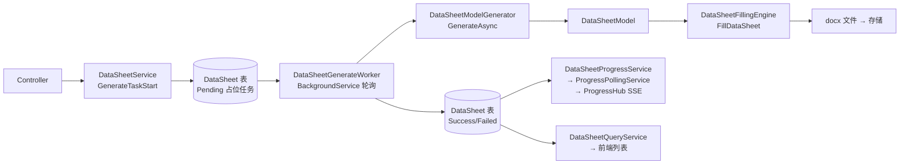
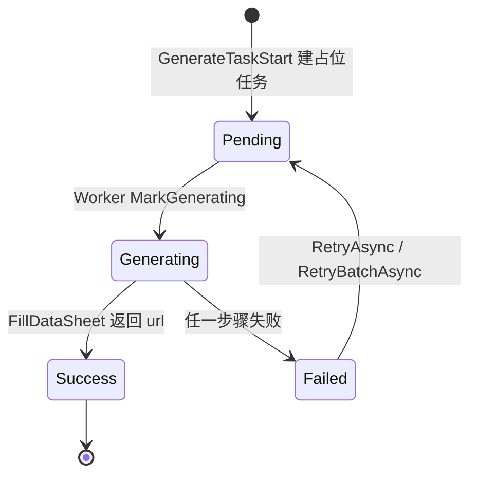

# DataSheetContext — 数据单（DataSheet）应用服务层

> 本文件是**该目录的协作入口文档**。任何人（含 AI）接手本目录前请先读完本文档，
> 即可掌握：目录职责、每个类的契约、上下游链路、生成流水线、已知缺陷与修复建议。
>
> 配套文档：`src\Infrastructure\TemplateEngine\WordTemplateAdapter\README.md`
> （下游填充层，本目录的 `DataSheetModel` 就是它的输入）
>
> 最后更新：基于 `7af8b1b`

---

## 0. 一句话定位

**把「检测清单（CheckList）」拆解成「数据单任务（DataSheet）」，异步生成 DataSheetModel，
再交给 Word 模板引擎产出 docx 文件，并对外提供状态查询 / 进度推送 / 编辑回调。**

本目录是**异步任务编排层**：请求进来只落库排队，真正的生成由后台 Worker 消费。
所以这里大量出现 `Pending / Generating / Failed / Success` 状态机、幂等、重试、并发恢复。

### 本目录在整条链路中的位置



---

## 1. 目录文件清单

| 文件 | 行数 | 类型 | 生命周期 | 一句话职责 |
|---|---|---|---|---|
| `DataSheetService.cs` | 305 | 应用服务 | `IScopedDependency` | **对外入口**：启动生成任务、重试、ONLYOFFICE 回调、标记完成/审批 |
| `DataSheetGenerateWorker.cs` | 327 | 后台任务 | `BackgroundService` | **生成流水线**：轮询 Pending → 生成模型 → 填模板 → 落状态 |
| `DataSheetModelGenerator.cs` | 436 | 领域编排 | `IScopedDependency` | **模型工厂**：CheckList → 参数分包 → 选模板 → `DataSheetModel` |
| `DataSheetQueryService.cs` | ~60 | 查询服务 | `IScopedDependency` | 按 CheckListId 查 DataSheet 列表 |
| `DataSheetProgressService.cs` | ~120 | 查询服务 | `IScopedDependency` | 汇总进度快照（含分布式缓存） |
| `DataSheetProgressHub.cs` | ~110 | 推送枢纽 | **`ISingletonDependency`** | SSE 连接注册表 + 快照哈希去重 + 广播 |
| `DataSheetProgressPollingService.cs` | ~85 | 后台任务 | `BackgroundService` | 定时取快照，变化才经 Hub 推给前端 |

> 注意：只有 `DataSheetProgressHub` 是 **Singleton**（必须持有所有 SSE 连接），
> 其余都是 Scoped。Worker 因此必须靠 `IServiceScopeFactory` 自建 scope。

---

## 2. 逐类详解（含入参协议）

### 2.1 `DataSheetService` — 对外入口

**依赖注入**（10 个，构造函数 L31-53）：
`IUnitOfWork`、`ICheckListRepository`、`IConditionPoolRepository`、`DataSheetFillingEngine`、
`ILogger<DataSheetService>`、`IDataSheetRepository`、`IWebHostEnvironment`、
`IFileStorageService`、`IDataSheetModelGenerator`、`IDataSheetBatchRepository`

| 方法 | 入参 | 出参 | 行为要点 |
|---|---|---|---|
| `GenerateTaskStart` | `DataSheetGenerateDto dto`、`CancellationToken ct` | `Task<Result<GenerateDataSheetTaskResult>>` | L62 |
| `RetryAsync` | `Guid dataSheetId`、`CancellationToken ct` | `Task<Result>` | L127 |
| `RetryBatchAsync` | `CheckListId checkListId`、`CancellationToken ct` | `Task<Result>` | L157 |
| `SaveFromOnlyOffice` | `string datasheetId`、`string url`、`CancellationToken ct` | `Task` | L184 |
| `MarkDone` | `Guid datasheetId`、`CancellationToken ct` | `Task<Result>` | L268 |
| `MarkApproved` | `string datasheetId`、`string url`、`CancellationToken ct` | `Task<Result>` | L290 |

**`GenerateTaskStart` 五步**（L62-122）：

1. 校验 CheckList 存在且 `Status == InProgress`，否则 `throw ArgumentException`；
2. **幂等**：`dto.ForceRegenerate == false` 时查 `GetActiveByCheckListIdAsync`，
   有未失败批次直接返回其 `(BatchId, CheckListId, Total)`；
3. 取模板 URL —— **当前硬编码** `"DocxModel/Common_WET/WET_Dimensional_Change_Wasing.docx"`（L88，注释已标"先固定，后续替换成真正的查询"）；
4. `DataSheetBatch.Create(...)` 建批次（`Total = checklist.Items.Count`）；
5. 按 `checklist.Items` 拆 N 个 **`Pending` 占位 DataSheet**（`modelIndex: 0`）。

> ⚠️ L117 明确注释：**不在这里生成文件、不推送**。所有生成工作都交给 Worker。
> 这是「请求快速返回」的关键设计，改代码时不要图省事在 Service 里同步生成。

**重试语义**：`RetryAsync` 只允许 `Failed → Pending`（状态不对返回 `Result.Fail`）；
`RetryBatchAsync` 走 `BulkMarkPendingAsync`，影响 0 行则回滚并返回失败。

**`SaveFromOnlyOffice` 幂等**：L199-200 有一段被注释掉的幂等逻辑
（注释原文「报错代码：后续用其他方式幂等」），说明该处幂等**当前是缺失的**，
重复回调会重复处理。见 §6.5。

---

### 2.2 `DataSheetGenerateWorker` — 生成流水线

**依赖注入**：`IServiceScopeFactory`、`ILogger<DataSheetGenerateWorker>`

| 方法 | 入参 | 出参 | 说明 |
|---|---|---|---|
| `ExecuteAsync` | `CancellationToken ct` | `Task` | 主循环，`while(!ct.IsCancellationRequested)` |
| `GenerateOne` | `DataSheet ds`、`List<ConditionPool> pools`、`IDataSheetModelGenerator`、`DataSheetFillingEngine`、`IDataSheetRepository`、`ICheckListRepository`、`IUnitOfWork`、`CancellationToken ct` | `Task` | 单个任务全流程（含事务） |
| `ExpandPendingTasks` | `DataSheet origin`、`IReadOnlyList<DataSheetModel> models`、`IDataSheetRepository`、`IUnitOfWork`、`CancellationToken ct` | `Task` | index=1..N-1 展开 |
| `IsTransient` | `Exception ex` | `bool` | 判可重试 |
| `IsUniqueViolation` | `DbUpdateException ex` | `bool` | SQL Server 2601/2627 |
| `ResolveModelKey` | `DataSheetModel model`、`int index` | `string` | `model.ModelKey` 或 `__index_{i}` |

**主循环 `ExecuteAsync`（L37-109）**：

```
每 1 秒一轮：
  CreateScope → 取 repo/generator/engine/poolRepo/uow/checklistRepo
  GetPendingAsync(batchSize: 20)          // 空则 Delay 1s continue
  按 CheckListId 分组 → 批量预取 ConditionPool（避免 N+1）
  Parallel.ForEachAsync(ids)：
      每个任务 CreateScope 独立 scope      // ★ 避免 DbContext 并发访问
      内层重新 GetByIdAsync 载入 ds         // ★ 不跨 scope 操作实体
      GenerateOne(...)
  catch(Exception) → LogError，不中断循环
  Delay 1s
```

**两个 ★ 是本类最重要的设计约束**：`IDataSheetRepository` 背后是 DbContext，
Scoped 且非线程安全，所以并行度靠「每任务一个 scope」实现，而不是共享实例。

**`GenerateOne` 全流程（L122-258，事务包裹）**：

1. `BeginTransactionAsync` → `ds.MarkGenerating()` → `UpdateAsync` + `SaveChangesAsync`
   （注释 ★「让 EF 跟踪变更」，不能省）；
2. 取 checklist → 为空 → `MarkFailed("CheckList not found", retryable: false)` + 提交返回；
3. 按 `TestItemId` 取 checklist item → 为空 → `MarkFailed("ChecklistItem not found", retryable:false)`；
4. **解析模型，优先读快照**：
   - `ds.ModelSnapshot` 非空 → 直接 `JsonSerializer.Deserialize<DataSheetModel>`（**不重复生成**）；
   - 否则调 `modelGenerator.GenerateAsync(pools, item, ct)`；
     - 结果为空 → `MarkFailed("Model generation returned empty", retryable:false)`；
     - 绑定 index=0 的 model → `ds.BindModel(key0, json)`；
     - `allModels.Count > 1` → `ExpandPendingTasks` 展开其余；
5. `fillingEngine.FillDataSheet(myModel)` 产出文件 URL；
   - 空 URL → `MarkFailed("FillDataSheet returned empty url", retryable:false)`；
   - 否则 → `MarkSuccess(fileUrl)`；
6. `UpdateAsync` + `SaveChangesAsync` + `CommitAsync`
   （注释 ★「一次 SaveChanges：展开 + 状态变更一起提交」）。

**异常恢复策略**（两段，均 rollback + **新建独立 recovery scope** 重新加载 latest 再写，
避免使用已失败的实体/上下文）：

| 异常 | 处理 |
|---|---|
| `DbUpdateException` 且 `IsUniqueViolation` | 若 latest 仍为 `Generating` → `MarkFailed("Concurrent expand detected, will retry", retryable: true)` |
| 其它 `Exception` | `retryable = IsTransient(ex)` → latest `MarkFailed(ex.Message, retryable)` |

**`ExpandPendingTasks`（L260-299）**：只允许在 `origin.ModelIndex == 0` 时调用
（否则记 Warning 直接返回）；`i = 1..N-1`；先用 `ExistsAsync(checkListId, testItemId, i)` **幂等**跳过已存在；
再 `DataSheet.Create(..., modelIndex: i)` + `BindModel`。**AddAsync 不 SaveChanges**，
由调用方 GenerateOne 统一提交。

**`IsTransient`**：`TimeoutException` / `IOException` / 消息含 `"503"` / 含 `"timeout"`（不区分大小写）。

> 这套「占位任务 + 模型快照 + 幂等展开」的组合，实质是把 **1 个 CheckListItem → N 个 DataSheet**
> 的扇出做成了**数据库驱动的队列**：第一次跑的 index=0 任务负责发现 N 并补建其余任务，
> 之后的每个任务只从自己的 `ModelSnapshot` 反序列化，不再重复调 `GenerateAsync`。

---

### 2.3 `DataSheetModelGenerator` — 模型工厂（重点）

这是 `DataSheetFillingEngine.FillDataSheet(DataSheetModel)` 的**唯一上游**，
也是本次链路追溯的焦点。

**依赖注入**：`IStandardRepository`、`ITemplateSelectService`

**入口协议**（接口 `src\Application\Interface\IDataSheetModelGenerator.cs`）：

```csharp
Task<List<DataSheetModel>> GenerateAsync(
    List<ConditionPool> pools,     // 该 CheckList 下所有条件池
    CheckListItem item,            // 本次要生成的检测项
    CancellationToken ct);
```

`pools` 是 **List**、返回也是 **List** —— 因为一个 item 会按参数分包
（`TestPointPackage`）产出**多份** DataSheetModel，每份对应一张数据单。

| 方法 | 入参 | 出参 | 职责 |
|---|---|---|---|
| `GenerateAsync` | 见上 | `Task<List<DataSheetModel>>` | 主入口，逐包生成模型 |
| `PackByParamSet` | `CheckListItem item` | `IReadOnlyList<TestPointPackage>` | **参数分包** |
| `CalculateDataAreaCount` | `CheckListItem item`、`TestPointPackage package` | `int` | 计算数据区个数（含水洗扩展） |
| `ExpandSampleArray` | `CheckListItem item`、`TestPointPackage package` | `string[]` | 按水洗次数展开**测点 ID 数组** |
| `CalcuteSampleMapAsync` | `CheckListItem`、`TestPointPackage`、`Template template`、`string[] samplemap` | `Task<SampleMap>` | 生成 `Sample_data_{n}` 书签映射 |
| `CalculateAfterWashMapAsync` | `CheckListItem`、`TestPointPackage`、`Template template`、`string[] afterWashArray` | `Task<AfterWashMap>` | 生成 `After_wash_data_{n}` 书签映射 |
| `ExpandAfterWashArray` | `CheckListItem item`、`TestPointPackage package` | `string[]` | 按水洗次数展开**水洗次数值数组** |
| `ExtractString` / `ExtractInt` | `object? raw` | `string` / `int` | 从 `JsonElement` / `ParamValue` / 原生类型安全取值 |

#### DataSheetModel 字段来源映射（改字段必看）

| 字段 | 取值来源 | 说明 |
|---|---|---|
| `ReportNumber` | `pool.Conditions["ReportNo"]` → `ExtractString` | 缺失则空串 |
| `SheetCount` | `pool.Conditions["Copy"]` → `ExtractInt(default: 1)` | 数据单份数 |
| `DataAreaCount` | `CalculateDataAreaCount(item, package)` | 见下 |
| `TemplateUrl` | `template.GetTemplateUrl()` | 由 `ITemplateSelectService` 选出 |
| `TestItem` | `item.TestItemId` | |
| `TestMethod` | `standards` 的 `StandardCode ?? StandardCodeNameEn ?? Id`，`;` 拼接 | 查不到则降级用 `item.StandardIds` |
| `TestCondition` | `TextReplaceHelper.FillTemplate(template.FindTextTemplate(pool.Conditions).Text, paramJson)` | `paramJson` 来自 `package.ParamSet.Values` 序列化 |
| `SampleMap` | `CalcuteSampleMapAsync(...)` | 书签 `Sample_data_1`、`Sample_data_2`… |
| `AfterWashMap` | `CalculateAfterWashMapAsync(...)` | 书签 `After_wash_data_1`… |

#### 三个核心算法

**① 参数分包 `PackByParamSet`（L138-174）**

按 `item.TestPointParams` 的 **ParamSet 值**分组，但分组键**必须先剔除 `WashCycle`**：

```csharp
// 「水洗次数不同不影响参数合并」——所以判等时排除 WashCycle
if ("WashCycle".Equals(v.Key, StringComparison.OrdinalIgnoreCase)) continue;
var key = JsonConvert.SerializeObject(filteredValues);
```

分组后 `Select(g => new TestPointPackage(TestPointIds: 排序后的测点 ID, ParamSet: g.First().Value))`
—— **保留原始 ParamSet（含 WashCycle）**，只用过滤后的键做聚合。
最终按 `TestPointIds.First()` 排序，保证输出顺序稳定。

> 这个「分组键排除某字段，但聚合体保留该字段」的手法，是全文件最容易读错的地方。

**② 数据区计数 `CalculateDataAreaCount`（L182-218）**

对 `package.TestPointIds` 逐个测点累加：
- 无参数配置 → `+1`；
- 有 `WashCycle` 且为 string（格式 `"1-2-32-45"`）→ 按 `-` 分割，**段数**即个数；
- 无 `WashCycle` → `+1`。

**③ 书签映射 `CalcuteSampleMapAsync`（L257-299）**

```
sampleDataCount      = template.TemplateStructure.SampleDataAreaCount   // 模板预留格数
actualDataAreaCount  = CalculateDataAreaCount(...)
actualDataAreaCount <= 0  → 返回空 SampleMap
否则  Sample_data_{i+1} = expandedSamples[i]
IsAppend = expandedSamples.Length >= sampleDataCount   // 是否需复制整块 data 表
```

`AfterWashMap` 同构，但**前缀判断不同**：先看 `template.TemplateStructure.AfterWashDataCount <= 0`
就直接返回空（模板没这块就不生成），键为 `After_wash_data_{n}`。

---

### 2.4 `DataSheetQueryService`

**依赖**：`IDataSheetRepository`

| 方法 | 入参 | 出参 |
|---|---|---|
| `GetDataSheetByChecklistId` | `Guid checklistId`、`CancellationToken ct` | `Task<Result<List<DataSheetResponseDto>>>` |

纯读，无副作用。给前端列表页用。

---

### 2.5 `DataSheetProgressService`

**依赖**：`IDataSheetRepository _dsRepo`、`IDataSheetBatchRepository _batchRepo`、`IDistributedCache _cache`

| 方法 | 入参 | 出参 | 说明 |
|---|---|---|---|
| `GetSnapshot` | 见实现 L34（checkListId + ct） | `Task<DataSheetProgressDto>` | 汇总进度，带分布式缓存 |
| `ComputeOverallStatus` | 各状态计数 | `string` | 推导整体状态 |
| `ToItemDto` | `DataSheet ds` | `DataSheetItemDto` | 单条映射 |

`IDistributedCache` 的存在说明快照会被缓存（多实例部署下跨进程共享），
改快照结构时要同步考虑缓存键与失效时机。

---

### 2.6 `DataSheetProgressHub`（Singleton）

**字段**：

- `ConcurrentDictionary<Guid, ConcurrentBag<SseEmitter>> _emitters` —— 每个 CheckList 挂多个 SSE 客户端
- `ConcurrentDictionary<Guid, string> _lastSnapshotHash` —— **每 CheckList 上次广播的快照哈希**

| 方法 | 入参 | 出参 | 说明 |
|---|---|---|---|
| `Register` | `Guid checkListId`、`SseEmitter emitter` | `void` | 建连登记 |
| `Unregister` | `Guid checkListId`、`SseEmitter emitter` | `void` | 断连摘除 |
| `GetActiveCheckListIds` | — | `IReadOnlyCollection<Guid>` | 有活跃连接的所有 CheckList |
| `HasChanged` | `Guid checkListId`、`DataSheetProgressDto snapshot` | `bool` | **哈希去重**：与上次相同则 false |
| `Broadcast` | `Guid checkListId`、`string eventName`、`object payload` | `Task` | 推给该 CheckList 所有连接 |
| `CloseAll` | `Guid checkListId` | `void` | 关闭全部连接 |
| `ComputeHash` | `DataSheetProgressDto dto` | `string` | 快照 → 哈希 |

**去重机制**是关键：`HasChanged` + `_lastSnapshotHash` 保证
「数据没变就不推」，避免轮询周期性地往 SSE 里灌重复消息。

---

### 2.7 `DataSheetProgressPollingService`

**依赖**：`IServiceScopeFactory`、`DataSheetProgressHub`、`ILogger`

| 方法 | 入参 | 出参 | 说明 |
|---|---|---|---|
| `ExecuteAsync` | `CancellationToken ct` | `Task` | 定时循环 |
| `IsCompleted` | `DataSheetProgressDto dto` | `bool` | 整体完成判定 |

工作方式：`GetActiveCheckListIds()` 取当前有人订阅的 CheckList →
自建 scope 取 `DataSheetProgressService.GetSnapshot` → `hub.HasChanged` 判定 → 变了才 `Broadcast`。
`IsCompleted` 为真时可 `CloseAll` 收尾。

> 为什么不让 Worker 直接推送？**解耦**：Worker 只管生成落库，推送归进度服务，
> 且「只推活跃订阅者」能省掉大量无意义查询。

---

## 3. 状态机



`MarkFailed(message, retryable)` 的 `retryable` 决定后续能否重试：

| 场景 | retryable | 依据 |
|---|---|---|
| CheckList / ChecklistItem 找不到 | `false` | 数据问题，重试无用 |
| `Model generation returned empty` | `false` | 同上 |
| `FillDataSheet returned empty url` | `false` | 同上 |
| 并发唯一键冲突 | `true` | `DbUpdateException` + 唯一约束 |
| `TimeoutException`/`IOException`/`503`/`timeout` | `true` | `IsTransient` |

---

## 4. 幂等与并发设计（本目录最值得牢记的部分）

| 层次 | 机制 |
|---|---|
| 请求层 | `GenerateTaskStart` 查 `GetActiveByCheckListIdAsync`，有活跃批次直接返回 |
| 任务展开 | `ExpandPendingTasks` 用 `ExistsAsync(checkListId, testItemId, modelIndex)` 先查后插 |
| 模型生成 | `ds.ModelSnapshot` 非空即复用，不重复调 `GenerateAsync` |
| 落库 | `ExpandPendingTasks` 只 Add 不 Save，交给 `GenerateOne` 一次提交 |
| 并发冲突 | 捕获唯一约束 → rollback → 独立 scope 重新加载 latest → `retryable: true` |
| 推送 | `HasChanged` 哈希去重 |
| ONLYOFFICE 回调 | ⚠️ **幂等缺失**，见 §6.5 |

---

## 5. 与下游填充层的接缝

```
DataSheetModelGenerator.GenerateAsync
        ↓  产出 List<DataSheetModel>
DataSheet.BindModel(key, JsonSerializer.Serialize(model)) → ds.ModelSnapshot  ★落库快照
        ↓  恢复时 JsonSerializer.Deserialize<DataSheetModel>(ds.ModelSnapshot)
DataSheetFillingEngine.FillDataSheet(model) → string fileUrl
```

**改 `DataSheetModel` 结构时必须同时检查三处**：
1. `DataSheetModelGenerator.GenerateAsync` 的构造（L99-124）；
2. Worker 的序列化/反序列化（`DataSheetGenerateWorker.cs:167`、`:186`、`:278`）；
3. `WordTemplateAdapter\DataSheetFillingEngine.cs` 的消费。

因快照是 JSON 落库的，**字段改名会让存量 Pending 任务的快照反序列化失败**（得到 null 值而非异常），
这是最容易踩的坑。详见 `WordTemplateAdapter\README.md` §7.1。

---

## 6. 已知缺陷与修复建议

### 6.1 【P1】`PackByParamSet` 遗留 `Console.WriteLine` 调试输出

- **位置**：`DataSheetModelGenerator.cs:163`
- **现状**：`Console.WriteLine($"[{kv.Key}] -> [{key}]");` 位于 `GroupBy` 的 keySelector 内，
  **每个测点都会打一行**，且 32 位参数序列化文本可能很长。
- **影响**：生产环境日志噪音 / 容器 stdout 膨胀；`GroupBy` 的 keySelector 应保持纯粹。
- **修复**：直接删除该行；确需观测请改用 `ILogger` 并降为 `Debug`。

### 6.2 【P1】`GenerateAsync` 丢弃传入的 `CancellationToken`

- **位置**：`DataSheetModelGenerator.cs:73`
- **现状**：`await _standardRepository.GetByIdsAsync(standardIds, CancellationToken.None);`
- **影响**：Worker 停止或任务取消时，这次查库不受控，无法及时中断。
- **修复**：改为传入方法签名里的 `ct`。

### 6.3 【P1】两个 `*MapAsync` 是 `async` 但内部无 `await`

- **位置**：`DataSheetModelGenerator.cs:257`（`CalcuteSampleMapAsync`）、`:304`（`CalculateAfterWashMapAsync`）
- **现状**：方法标记 `async Task<T>`，方法体全是同步代码，无任何 `await`。
- **影响**：编译告警 CS1998；每次调用都白白分配一个状态机；名字里的 `Async` 具误导性。
- **修复**：二选一 ——
  - 去掉 `async`，改为 `Task.FromResult(...)`（最小改动）；
  - 或改成同步方法 `SampleMap CalculateSampleMap(...)`，并同步调整
    `GenerateAsync` 与接口 `IDataSheetModelGenerator` 的签名（更彻底）。
- **附带**：方法名 `CalcuteSampleMapAsync` 拼写错误（`Calcute` → `Calculate`），改名注意 Redis/JSON 兼容性无关，可安全重命名。

### 6.4 【P2】`ExpandAfterWashArray` 注释与实现不一致

- **位置**：`DataSheetModelGenerator.cs:359`、`:376`
- **现状**：两处都写 `// 无参数配置，默认0次`，但代码是 `expandedAfterWashes.Add("1")`。
- **影响**：读者会误判水洗基线次数，进而误判 `After_wash_data_*` 的语义。
- **修复**：确认业务口径后**改注释**（大概率应是「默认 1 次」），不要盲目改代码。

### 6.5 【P1】`SaveFromOnlyOffice` 幂等缺失

- **位置**：`DataSheetService.cs:199-200`
- **现状**：原有幂等逻辑被注释掉，注释原文「报错代码：后续用其他方式幂等」。
- **影响**：ONLYOFFICE 回调重试（网络抖动、超时重发）会导致同一文件被重复处理。
- **修复方向**：用「datasheetId + callback url 摘要」做幂等键，写入 `IDistributedCache`
  或增加 `LastCallbackHash` 列；命中则直接返回成功。

### 6.6 【P2】`GenerateTaskStart` 模板 URL 硬编码

- **位置**：`DataSheetService.cs:88`
- **现状**：`var contactTemplateUrl = "DocxModel/Common_WET/WET_Dimensional_Change_Wasing.docx";`
  注释已标「先固定，后续替换成真正的查询」。
- **影响**：所有 CheckList 都会拿到同一份模板 URL，与 `DataSheetModelGenerator`
  里 `template.GetTemplateUrl()`（按参数精确选模板）**存在双份来源**。
- **修复方向**：`contactTemplateUrl` 只作占位/兜底，真实来源应统一到
  `ITemplateSelectService`；或在占位任务建好后由 Worker 用选中的模板回写。

### 6.7 【P2】`ConditionPool` 匹配是子集匹配，可能命中过大池

- **位置**：`DataSheetModelGenerator.cs:51-53`
- **现状**：`pools.FirstOrDefault(p => p.TestPoints != null && target.All(x => p.TestPoints.Contains(x)))`
- **问题**：只要求「池包含本包全部测点」，不要求相等。当存在一个覆盖范围更大的池时，
  `FirstOrDefault` 可能先命中它，导致取到**不属于本包的 Conditions**。
- **修复方向**：改为精确匹配（`p.TestPoints.Count == target.Count && target.All(...)`），
  或按「包含且测点数最少」排序后取首个。

### 6.8 【P2】`ExpandSampleArray` 与 `ExpandAfterWashArray` 高度重复

- **位置**：`DataSheetModelGenerator.cs:223-255` 与 `:348-381`
- **差异**：循环骨架完全相同，只有「往数组里放什么」不同
  （前者放 `testPointId`，后者放 `washNumber`）；空值兜底也不同（前者 `testPointId`，后者 `"1"`）。
- **修复方向**：抽 `T[] ExpandByWashCycle<T>(TestPointPackage, Func<string,string[]>)`，
  两个调用点各传一个投影函数，消除约 30 行重复。

### 6.9 【P2】Worker 无并发上限与单轮超时

- **位置**：`DataSheetGenerateWorker.cs:75`（`Parallel.ForEachAsync` 未传 `MaxDegreeOfParallelism`）
- **现状**：默认并行度 = CPU 核数，但每任务又自建 scope + DbContext + 事务。
- **风险**：`batchSize: 20` 在核数较多机器上会同时压出 20 个事务；DB 连接池可能成为瓶颈，
  再叠加 `Task.Delay(1000)` 的固定节拍，吞吐不可控。
- **修复方向**：显式设 `MaxDegreeOfParallelism`（如 4~8），或改为可配置项。

---

## 7. 拓展方向

### 7.1 新增一种「数据单」报告类型的流程

1. **模板侧**：按 `WordTemplateAdapter\README.md` §8.1 新增 `XxxDocxEngine`；
2. **选择侧**：确认 `ITemplateSelectService` 能按 `runtimeConditions` 选出新模板
   （`FindByIndex(..., preFilterKey: "TestItemId")` 依赖 `TestItemId` 在 conditions 里，
   `GenerateAsync` L90 已注入，新增检测项无需改动）；
3. **模型侧**：若 `DataSheetModel` 字段不足，**先扩 DTO**，再同步 §5 的四处；
4. **填充分发**：`DataSheetFillingEngine.FillDataSheet` 目前按 `TemplateUrl` 分流，
   新模板要么复用书签约定，要么在 `FillDataSheet` 内加分支（**不建议**，见 7.3）；
5. 补一条 `RetryAsync` 场景验证：故意让 `FillDataSheet` 返回空 URL，确认状态落 `Failed(retryable:false)`。

### 7.2 提升生成吞吐

| 方向 | 说明 | 优先级 |
|---|---|---|
| 并行度可配置 | 见 §6.9 | 高 |
| 取消传播 | 修 §6.2，让停机时任务能快速中断 | 高 |
| 批量落状态 | 现在每任务一次 `SaveChanges` + 一次事务，可考虑按批提交 | 中 |
| 失败分类细化 | `IsTransient` 目前靠字符串匹配 `"503"`/`"timeout"`，应改为异常类型判断 | 中 |

### 7.3 架构层面的收敛建议

- **`DataSheetFillingEngine` 的分发应收敛**：目前 Worker/Service 都直接 `GetRequiredService<DataSheetFillingEngine>()`
  （具体类，非接口），意味着该层被硬绑定。建议定义 `IDataSheetFillingEngine` 并在其上做
  按模板类型的分发，避免每加一种模板就改 `FillDataSheet` 内部 if 分支。
  （注：`WordTemplateAdapter` 层其余引擎都已有接口，唯独它没有 —— 见该目录 README §7.5。）
- **进度推送与生成解耦已做对**，保持：不要在 `GenerateOne` 里直接 `Broadcast`。
- **`ModelSnapshot` 是重要资产**：它让「重试/补偿」不必重算模型。若未来要换 DTO 版本，
  建议在快照 JSON 加 `SchemaVersion` 字段，读时按版本迁移。

---

## 8. 排错提示

| 症状 | 首先怀疑 |
|---|---|
| 任务一直 `Pending` 不动 | Worker 是否注册为 Hosted Service；`GetPendingAsync` 是否返回；循环是否被异常吞掉（看 `DataSheetGenerateWorker error` 日志） |
| 状态停在 `Generating` | `FillDataSheet` 抛异常且 recovery 失败；查 `GenerateOne failed for {Id}` |
| 一个 item 只生成 1 份，应有 N 份 | `allModels.Count > 1` 未触发（`PackByParamSet` 分组过粗）；或 `modelIndex` 唯一键冲突被 `retryable:true` 吞掉 |
| 重复生成 / 同一数据单两份 | `ExistsAsync` 幂等失效；或 `GenerateTaskStart` 的 `ForceRegenerate` 被置 true |
| 前端进度不动 | `GetActiveCheckListIds` 为空（没人订阅）；或 `HasChanged` 一直返回 false（哈希未变）|
| 水洗相关格数不对 | `CalculateDataAreaCount` 的 `WashCycle` 解析（分隔符必须是 `-`，且必须是 `string` 类型）|
| 参数合并结果不对 | `PackByParamSet` 是否误把 `WashCycle` 纳入分组键 |
| 报告号为空 | `pool.Conditions` 里没有 `ReportNo` 键（不是 null 值，而是键不存在）|

---

## 9. 修改本目录的硬性约定

1. **业务计算只允许在 Application 层**；`DataSheetModel` 里的数字必须是已算好、已舍入的定稿值。
2. **不要在 `DataSheetService` 里同步生成文件** —— 请求必须快速返回（L117 的设计意图）。
3. Worker 内**每个并行任务必须独立 scope**，禁止跨 scope 复用实体或 DbContext。
4. `ExpandPendingTasks` **只 Add 不 Save**，提交权归 `GenerateOne`。
5. 失败标记必须显式给 `retryable`，不要留默认值蒙混。
6. 改 `DataSheetModel` 结构 → 同步检查 §5 的四处 + 快照反序列化兼容性。
7. 所有 `*Repository` 调用都要传业务 `ct`，不要用 `CancellationToken.None`（§6.2 的反例）。
8. 新增后台服务注意生命周期：Singleton 不能直接注入 Scoped，必须走 `IServiceScopeFactory`。
