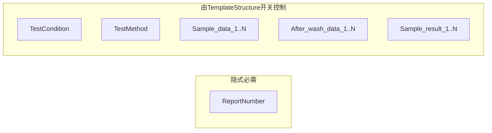
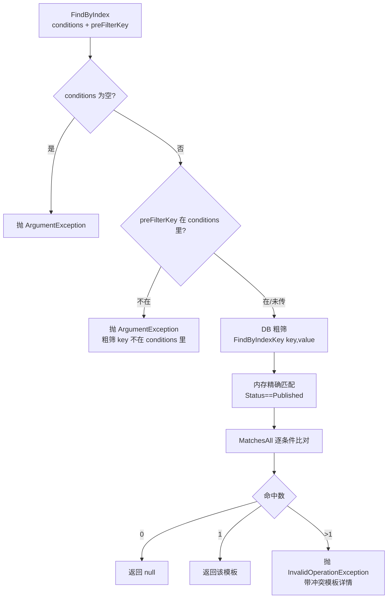

# TemplateEngine — 模板引擎公共层 / Word 模板建立约定

> 本文件是**该目录的协作入口文档**，同时是**Word 模板（.docx）建立约定的事实规格**。
> 任何人（含 AI）接手模板相关改动前请先读完。
>
> 关联文档：
> - `WordTemplateAdapter\README.md` —— 按报告类型分发的各填充引擎
> - `src\Application\Service\DataSheetContext\README.md` —— 上游 DataSheetModel 生成链路
>
> 最后更新：基于 `7af8b1b`

---

## 0. 本目录是什么

模板引擎的**公共能力层**。`WordTemplateAdapter\` 子目录放"一种检测报告一个引擎"的具体填充器，
本层放它们共用的底层手段与通用引擎。

| 文件 | 作用 | 本轮核实程度 |
|---|---|---|
| `TextReplaceHelper.cs` | `{key}` 占位符文本填充（通用，与 docx 无关） | ✅ 已全文核实 |
| `WordEditEngine.cs` | docx 单元格/行级编辑（`AppendClonedRow` 等，被多个 Adapter 复用） | 部分（仅确认 `AppendClonedRow` 被 `PhysicalWeightDocxEngine.cs:70` 使用） |
| `WordTemplateEngine.cs` | 书签驱动的通用 Word 模板引擎 | 未核实 |
| `ExcelTemplateEngine.cs` | Excel 模板引擎对应实现 | 未核实 |
| `DocxMerger.cs` | docx 合并 | 未核实 |
| `TextRunHelper.cs` | Run 级文本处理 | 未核实 |
| `BarcodePictureHelper.cs` | 条形码图片生成/插入 | 未核实 |
| `WordTemplateAdapter\` | 子目录，按报告类型分发的 8 个填充引擎 | 见该目录 README |

> 未核实的文件不要在改动时凭文件名推测行为，先读。

---

## 1. Word 模板建立约定（核心）

约定分三层，**强制力逐层递减**，其中 L2 是硬校验。

| 层 | 约定内容 | 强制力 | 执行者 |
|---|---|---|---|
| L1 物理层 | 存哪个目录、文件名怎么拼 | 聚合自动生成，不可手填 | `Template.BuildPath` / `BuildFileName` |
| L2 结构层 | 必须埋哪些书签、各埋几个 | **发布前硬校验，缺一个即拒绝** | `WordTemplateValidator.ValidateBookmarks` |
| L3 内容层 | 书签语义、条件文本、索引匹配 | 运行时消费，不匹配则静默失效 | `DataSheetFillingEngine` / `TextReplaceHelper` / `TemplateSelectService` |

### 1.1 L1 物理约定：文件名是算出来的

`src\Domain\Aggregeates\TemplateContext\Template.cs:443-460`

$$\text{TemplateUrl} = \Big/\underbrace{\text{DocxModel}\mid\text{ExcelModel}}_{\text{ModelFolder()}}\Big/\underbrace{\text{BusinessCategory}}_{\text{业务分类}}\Big/\text{Sanitize}(\text{TemplateName})\_{{\large v}\text{Version}}\_{yyyyMMddHHmmss}.\text{docx}$$

| 规则 | 细节 | 位置 |
|---|---|---|
| URL 形态 | **相对 WebRoot 路径**，含前导 `/`、**不含 `wwwroot` 段** | L437-441 注释 |
| 为何不存绝对 URL | `wwwroot` 是物理根非 URL 段（拼进去 404）；绝对 URL 会把 host 烤进库，换端口/反代即失效 | L437-441 |
| 扩展名/目录 | `Docx → .docx / DocxModel`；否则 `.xlsx / ExcelModel` | L458-460 |
| 净化规则 | `/`、`\`、`..` **直接抛异常**（不静默改写）；空格与非法字符→`_`；首尾 `.`/`_` 削掉；净化后为空抛异常 | L467-490 |
| 分类同净化 | `BusinessCategory` 与 `TemplateName` 走同一套，防路径穿越 | L110 |
| 文件名重生成时机 | 仅 `UpdateWithNewFile`（版本+1，L281）、`RegenerateUrl`（L359）、`Rollback`（L409） | — |
| 普通 `Update` | **只换目录、保留文件名**（改名会让盘上文件与 URL 失联） | L186-188 |
| `Publish` | **刻意不重生成 URL**（`RegenerateUrl` 内含 `EnsureDraftStatus`，此刻状态已变会自炸） | L382-383 |

> **运维硬约定**：发布/回滚/重传后，调用方**必须同步把盘上文件搬到新路径**，否则 URL 指向空文件（L365、L392 注释反复强调）。

### 1.2 L2 结构约定：5 个计数 ↔ 5 组书签

`src\Infrastructure\Service\WordTemplateValidator.cs:57-120`

| `TemplateStructure` 字段 | 校验条件 | 模板必须包含的书签 |
|---|---|---|
| `TestConditionCount` | `> 0` | `TestCondition`（**单个**，不编号） |
| `TestMethodCount` | `> 0` | `TestMethod`（**单个**，不编号） |
| `SampleDataAreaCount` | `= N` | `Sample_data_1` … `Sample_data_N` |
| `AfterWashDataCount` | `= N` | `After_wash_data_1` … `After_wash_data_N` |
| `SampleResultAreaCount` | `= N` | `Sample_result_1` … `Sample_result_N` |

关键：L74-86 是**被注释掉的旧逻辑**（原本校验 `TestCondition_{i}` / `TestMethod_{i}` 编号书签），
改成 L88-96 的"只看单个书签是否存在"。即这两个计数已从「数量」退化为「**存在性开关**」：
填 `1` = 本模板需要该字段，填 `0` = 不需要。

加上**不受结构控制但填充侧总会写**的 `ReportNumber`，模板必备书签全集：



### 1.3 L3 内容约定：书签语义与值来源

`WordTemplateAdapter\DataSheetFillingEngine.cs:54-81`（`BuildBookmarkValues`）是唯一写入清单：

| 书签 | 值来源 |
|---|---|
| `ReportNumber` | `DataSheetModel.ReportNumber` ← `pool.Conditions["ReportNo"]` |
| `TestMethod` | `DataSheetModel.TestMethod` ← standards 的 `StandardCode ?? StandardCodeNameEn ?? Id` 以 `;` 拼接 |
| `TestCondition` | `TextReplaceHelper.FillTemplate(template.FindTextTemplate(conditions).Text, paramJson)` |
| `Sample_data_{n}` | `SampleMap.SampleMetaData`（按水洗次数展开后的测点 ID） |
| `After_wash_data_{n}` | `AfterWashMap.AfterWashMetaData`（按水洗次数展开的具体次数值） |

**长文本不在 docx 里**：`TestCondition` 的正文作为「条件文本模板」存在模板实体的关联数据中，
docx 里只留一个 `TestCondition` 书签接最终结果。

---

## 2. 三个待确认问题的核实结论

### 2.1 匹配算法（`TemplateSelectService.FindByIndex`）

**实际位置**：`src\Domain\Services\TemplateQueryService.cs:21-70`
（注意：**文件名 `TemplateQueryService.cs` 与类名 `TemplateSelectService` 不一致**，搜索时容易漏）

四步：



**确证要点**：

| 环节 | 实际行为 | 位置 |
|---|---|---|
| 粗筛 key | 传了 `preFilterKey` 但不在 conditions 里 → **抛异常**；未传则取 `conditions.First()`（**依赖字典枚举顺序**） | L30-41 |
| DB 粗筛 SQL | `SELECT * FROM templates WHERE JSON_VALUE(template_index, '$.' + {0}) = {1}`，参数为 `key` 与 `value?.ToString() ?? ""` —— **字符串精确等值**，非数值比较 | `TemplateRepository.cs:201-214` |
| 状态过滤 | 只认 `TemplateStatus.Published`（`Draft=0 / Superseded=1 / Published=2 / Archived=3`，**无 `Active` 枚举值**） | L48、`Enums\TemplateStatus.cs` |
| 逐条件匹配 | `MatchesAll`：遍历 **conditions**，index 里没有该 key → `continue`（跳过不算不匹配）；有则 `AreEqual` 必须相等 | L83-95 |
| 值比较 | `string` 走 `Trim()` + `OrdinalIgnoreCase`；两者皆数值走 `Convert.ToDecimal` 比较 | L100-116 |
| 唯一性 | **不是"命中即停"** —— 全量 `MatchesAll` 后再判 `Count`；`==0` 返 null，`>1` **抛异常**，`==1` 返回 | L53-69 |

> ⚠️ **与你的描述存在一处差异**：你说"检索到唯一即停止"，实际实现是「**全量匹配后要求唯一，冲突即抛异常**」（L57-67）。
> 语义上确实要求唯一，但实现上不早停。这带来一个实际差别：命中 2 个时是**抛错**而非返回第一个 ——
> 排查线上"索引条件命中了 N 个模板"报错时要按这个逻辑找重复 index，而不是找排序。

**"多传 `TestMethod` 会误伤匹配"的机制（已确证）**：

`MatchesAll` 会检查 conditions 中**每一个在 index 里也出现的 key**。`DataSheetModelGenerator.cs:91` 把
`TestMethod` 塞进了 `runtimeConditions`（值是由 `;` 拼接的标准号串）。因此：

- 某模板 `TemplateIndex` 若**没配** `TestMethod` → 该 key 被 `continue` 跳过，**不影响**；
- 若**配了** `TestMethod` → 必须与拼接串**逐字符相等**（仅 Trim + 忽略大小写）→ 极易误伤。

**附加风险（推断，需验证）**：`TestMethod` 由
`standards.Select(s => s.StandardCode ?? s.StandardCodeNameEn ?? s.Id.Value)` 拼接，
若 `IStandardRepository.GetByIdsAsync` **不保证返回顺序**，同一组标准可能拼出 `A;B` 或 `B;A`，
导致匹配结果不稳定。建议改用 `OrderBy(s => s.Id.Value)` 后再拼接，消除这个不确定性。

### 2.2 占位符语法：确认为 `{key}`

`src\Infrastructure\TemplateEngine\TextReplaceHelper.cs:54`

```csharp
Regex.Replace(template, @"\{([^{}]+)\}", match => { ... })
```

| 能力 | 说明 | 位置 |
|---|---|---|
| 简单字段 | `{Name}` | L10 |
| 嵌套路径 | `{Product.Name}` | L11 |
| 数组索引 | `{Orders[0].Id}` | L12、`ParsePath` L267-313 |
| 大小写不敏感 | `TryGetPropertyIgnoreCase`：先精确匹配，再遍历忽略大小写 | L163-180 |
| **缺失键** | **保留原占位符原文**（`value ?? match.Value`）—— 不会留空，也不会抛错 | L62-63 |
| 数组 | `", "` 连接（`ArraySeparator`） | L22、L241-251 |
| ParamValue 拆包 | 对象含 `Value` 字段则递归取 `Value` | L222-236 |
| 包装层剥离 | `Unwrap` 剥 `values`/`value`/`data`/`items`，最多 5 层，且仅当 `propCount <= 2` | L77-126 |

**两处值得注意的小问题**：

1. `UnitFieldNames = { "Unit" }`（L28）**定义后从未使用**（`ExtractFromObject` 只遍历 `ValueFieldNames`）。
   类注释 L13 说"`{X.Unit}` 也可单独取" —— 实际是靠**通用属性路径**取到的，与此常量无关。属死代码。
2. 缺失键保留 `{key}` 原文的行为，意味着**模板写错占位符不会报错，会原样打印 `{xxx}` 到报告里**。
   这是排查"报告里出现花括号"类问题的第一线索。

### 2.3 人工录入 + 一致性校验：实际闸门链

**已确认的 DDD 事实**：`TemplateStructure` 由人工录入；聚合根 `Template` **不持有** `ITemplateValidator`
（校验器在 `src\Infrastructure\Service\WordTemplateValidator.cs`，属于 Infrastructure，由应用层调用），
所以"聚合根内的 active 验证"在代码里**不体现为某个 `ValidateActive` 方法**（全库 grep 无此符号）。

真正保证 "runtime 下模板与结构数据一致" 的是四道闸门：

| 闸门 | 校验内容 | 位置 |
|---|---|---|
| ① 改结构/索引只能在 Draft | `EnsureDraftStatus` 拦 `UpdateStructure` / `UpdateMetadata` / `UpdateWithNewFile` / `UpdateIndex` / `RegenerateUrl` | `Template.cs:207/225/271/340/357` |
| ② `Publish` 前置非空检查 | `Status==Draft` + `TemplateStructure != null` + `TemplateIndex.Values.Count > 0`，任一不满足抛 `InvalidOperationException` | `Template.cs:367-388` |
| ③ 发布前 docx 实际校验 | `TemplateStructure==null`、文件不存在、**缺书签**、含嵌入对象/外部链接/AltChunk → 全部返回 `false` | `WordTemplateValidator.cs:25-161` |
| ④ 运行时双重过滤 | 只取 `Status==Published` + `TemplateIndex!=null` + `MatchesAll` 唯一命中 | `TemplateSelectService.cs:48-69` |

**闸门②与③职责不同，不要混淆**：`Publish` 只校验"元数据非空"，
真正打开 docx 验证书签的是 `WordTemplateValidator`。若某调用路径跳过了 validator 直接 `Publish`，
就会出现"结构数据说有 3 个样品格、实际 docx 只有 2 个"的静默错位 —— 这是最需要守住的一环。

---

## 3. 约定与实现的四个断层

### 3.1 `Sample_result_*` 只校验、永不填充

`WordTemplateValidator.cs:110-114` 要求 `Sample_result_1..N` 必须存在，
但 `DataSheetFillingEngine.BuildBookmarkValues` **没有任何写入 `Sample_result_*` 的逻辑**。
→ 这类书签是"必须埋、埋了永远空白"。

**处置建议（二选一，需业务确认）**：
- 若确无数据来源 → 从校验器移除该检查，并把 `SampleResultAreaCount` 标为保留字段；
- 若本应填充 → 在 `DataSheetModel` 补 `SampleResultMap`，由 `DataSheetModelGenerator` 生成。

### 3.2 `SheetCount` / `DataAreaCount` 算了但没用

`DataSheetModel` 有这两个字段，`DataSheetModelGenerator` 也算得仔细
（`CalculateDataAreaCount` 按 `WashCycle` 分段累加），但 `DataSheetFillingEngine` **完全不消费**。
它们的真实用途是**驱动扩容决策**（`SampleMap.IsAppend = expandedSamples.Length >= sampleDataCount`），
不是往表格里填数。**不要误以为少填了两个单元格**。

### 3.3 书签大小写：校验不敏感，填充敏感

```csharp
// WordTemplateValidator.cs:69 —— 忽略大小写
var bookmarks = body.Descendants<BookmarkStart>()
    .Select(b => b.Name?.Value)
    .ToHashSet(StringComparer.OrdinalIgnoreCase);

// DataSheetFillingEngine.cs:88 —— Dictionary<string,string> 默认区分大小写
.Where(b => bookmarkValues.ContainsKey(b.Name!))
```

模板写 `reportnumber`：**发布校验通过，运行时静默不填**。这是最隐蔽的一类故障。

### 3.4 书签位置与跨段落约束

- 校验器只扫 `Body`（`WordTemplateValidator.cs:66`），填充器也只扫 `Body`（`DataSheetFillingEngine.cs:88`）
  → **页眉/页脚里的书签既不被校验也不会被填**。
- 填充用 `paragraph.Elements<Run>().SkipWhile(...).TakeWhile(...)`（L101-104）取书签内 Run，
  要求 `BookmarkStart` / `BookmarkEnd` 与目标 Run **同处一个 Paragraph**。
  跨段落或跨单元格 → 走 L130-135 兜底分支：`InsertAfter(new Run(...))`，
  **不继承样式、也不清理原残留内容** → 文档结构被破坏。

---

## 4. 修改建议

### 4.1 约定治理（优先做，成本低、收益高）

| # | 建议 | 理由 | 落点 |
|---|---|---|---|
| G1 | **统一书签大小写策略**：把 `bookmarkValues` 改为 `new Dictionary<string,string>(StringComparer.OrdinalIgnoreCase)` | 消除 §3.3 的静默失效 | `DataSheetFillingEngine.cs:56` |
| G2 | **模板建立 checklist 落文档**：把 §1 的三层约定写成模板制作 SOP，随模板一起归档 | 目前约定只活在代码里，模板制作者看不到 | 文档 |
| G3 | **`Sample_result_*` 二选一收口** | 见 §3.1，现状是"要求埋但不填"的自相矛盾 | 校验器或 Generator |
| G4 | `TestMethod` 拼接前 `OrderBy` | 消除索引匹配的不确定性（§2.1 附加风险） | `DataSheetModelGenerator.cs:77` |

### 4.2 代码修复

| 优先级 | 问题 | 位置 | 修复方向 |
|---|---|---|---|
| P0 | 书签大小写不一致致静默不填 | `DataSheetFillingEngine.cs:56` | 字典传 `StringComparer.OrdinalIgnoreCase` |
| P0 | 硬编码模板路径与约定/实际均不符 | `DataSheetService.cs:88` | 见下文专项说明 |
| P1 | 跨段落书签替换破坏结构 | `DataSheetFillingEngine.cs:101-135` | 按 `BookmarkStart→BookmarkEnd` 文档序区间处理；跨段落时逐 Run 清空后在起点插入 |
| P1 | 页眉页脚书签完全不处理 | `DataSheetFillingEngine.cs:88` | 抽出 `EnumerateAllParts(mainPart)` 纳入 `HeaderParts`/`FooterParts` |
| P2 | `ValidateSecurity` 的"宏检查"是死代码 | `WordTemplateValidator.cs:133-135` | 查的是 `AltChunk`，`hasMacros` 声明后未使用；应删除或改查真实 VBA 项目 |
| P2 | `UnitFieldNames` 死代码 | `TextReplaceHelper.cs:28` | 删除，或让 `ExtractFromObject` 真正支持显式 Unit 取值 |
| P2 | 文件与类名不一致 | `Domain\Services\TemplateQueryService.cs` 内定义 `TemplateSelectService` | 重命名文件为 `TemplateSelectService.cs`，降低搜索成本 |
| P3 | `Unwrap` 的 `propCount <= 2` 启发式 | `TextReplaceHelper.cs:108` | 参数 JSON 若恰好只有 1~2 个属性且首属性名为 `value`，会被误剥；建议改为白名单式显式声明 |

**P0 专项：`DataSheetService.cs:88` 的硬编码路径**

```csharp
var contactTemplateUrl = "DocxModel/Common_WET/WET_Dimensional_Change_Wasing.docx";
```

三处不符：无前导 `/`（与 `BuildPath` 产出格式不符）、无 `_v{n}_{时间戳}` 后缀、
且 `wwwroot\DocxModel\Common_WET\` 实际只有 `..._Fabric_v1_20260924153018.docx`，**盘上无同名文件**。
`WordTemplateValidator` 的取路径逻辑是 `TemplateUrl.TrimStart('/','\\')` 后与 WebRoot 拼接，
因此该串指向不存在的文件。当前它是占位值（L88 注释"先固定，后续替换成真正的查询"），
但一旦被 `IFileStorageService.CopyTemplate` 真正使用即为必现故障。
**建议**：改为走 `ITemplateSelectService.FindByIndex`，与 `DataSheetModelGenerator` 统一模板来源，
彻底消除"双份模板来源"。

### 4.3 建议补的测试（当前工作区无测试项目）

| 测试 | 断言内容 | 价值 |
|---|---|---|
| 模板契约测试 | 对每个 `wwwroot\DocxModel\**\*.docx` 跑一遍 `WordTemplateValidator.ValidateBookmarks`（结构数据取模板记录或按书签实际数量反推） | 模板改版即报警，替代人工核对 |
| 书签大小写用例 | 模板书签写成小写 → 断言填充后**内容确实变了** | 锁住 §3.3 修复 |
| 索引唯一性用例 | 构造两个 index 相同的 Published 模板 → 断言 `FindByIndex` **抛 `InvalidOperationException`** | 锁住 §2.1 的"要求唯一"语义 |
| 占位符缺失用例 | `FillTemplate("{NotExist}", "{}")` → 断言返回 `"{NotExist}"` | 锁住"保留原文"行为，避免误改成留空 |
| 文件名生成用例 | `Template.Create(...)` → 断言 URL 匹配 `^/DocxModel/{Category}/{Name}_v1_\d{14}\.docx$` | 锁住 L1 约定 |
| 路径穿越用例 | `TemplateName = "../../etc/passwd"` → 断言抛 `ArgumentException` | 锁住 §1.1 净化规则 |

> 这些用例都是**纯函数级**的（除模板契约测试需读磁盘 docx），引入测试项目的成本远低于线上排查成本。

---

## 5. 落地顺序建议


A、B 两处是"改一行、零风险、立消隐患"的，建议先做；
E 涉及 XML 结构改写，务必先补 §4.3 的模板契约测试与书签大小写用例再动。

---

## 6. 一句话备忘

> **模板的约定不在文档里，在 `WordTemplateValidator` + `BuildBookmarkValues` + `MatchesAll` 三处代码里。**
> 改模板前查这三个，改约定时三处必须同步 —— 任何一处不同步，故障都会以"静默空白/静默错位"的形式出现，
> 而不是报错。
