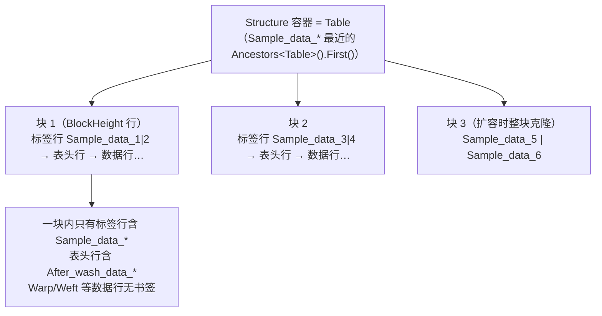

# WordTemplateAdapter — Word 模板填充适配层

> 本文件是**该目录的协作入口文档**。任何人（含 AI）接手本目录前请先读完本文档，
> 即可掌握：目录职责、每个类的契约、共性机制、拓展步骤、已知缺陷与修复建议。
>
> 最后更新：基于 `7af8b1b`（fix(DryingRate): 报告速率均值按页各算各的）

---

## 0. 一句话定位

**把 Application 层算好的 DTO 数据，按坐标写进预先设计好的 `.docx` 模板文件。**

本层只做「定位 + 落格 + 排版保真」，**不做任何业务计算** —— 平均值、舍入、判定结论都在
Application 层的 `*ReportService` 里算完，这里只负责把定稿数字放到正确的位置。

一个检测标准 / 报告类型 ↔ 一个 Engine。文件命名 `*DocxEngine` 与 `*WordTemplateAdapter` 混用，
但职责同构，不要因为后缀不同而认为架构分层有差异。

---

## 1. 目录文件清单

| 文件 | 行数级 | 契约接口 | 直接改 docx？ | 模板选择维度 |
|---|---|---|---|---|
| `DataSheetFillingEngine.cs` | ~140 | 无 | 是（**书签替换**） | 单一模板 |
| `CheckListAdapter.cs` | ~500 | 无 | 是（含条形码图片） | 单一模板 |
| `DryingRateDocxEngine.cs` | ~700 | `IDryingRateDocxEngine` | 是（含图表图片） | 双实现：整表克隆 / 按页分页 |
| `Aatcc201DocxEngine.cs` | ~930 | `IAatcc201DocxEngine` | 是 | 单一模板（含反向解析） |
| `AbrasionResistanceDocxEngine.cs` | 531 | `IAbrasionResistanceDocxEngine` | 是 | 单一模板 |
| `PhysicalWeightDocxEngine.cs` | 738 | `IPhysicalWeightDocxEngine` | 是 | **按买家 4 套模板** |
| `YarnCountDocxEngine.cs` | 771 | `IYarnCountDocxEngine` | 是 | **按布种 2 套模板**（Woven / Knit） |
| `FiberAnalysisWordTemplateAdapter.cs` | 469 | `IWordTemplateAdapter` | **否**（产出书签字典） | 单一模板 |

契约接口统一位于 `src/Infrastructure/Interface/`（如 `IDryingRateDocxEngine.cs`）。

---

## 2. 两种实现范式（先分清这个，再看任何类）

### 范式 A：书签驱动（少量类使用）

```
Engine 产出 Dictionary<书签名, 文本>  →  通用替换器遍历 docx 书签落值
```

代表：`FiberAnalysisWordTemplateAdapter`。它**完全不 Open 文件**，只做数据拍平，
把 `AnalysisResult` 翻译成四组书签信息交给上层通用引擎。这种范式最安全、最模板化。

### 范式 B：坐标驱动（绝大多数类使用）

```
Engine 自己 WordprocessingDocument.Open → 按行列坐标 SetCellText → Save
```

坐标来源是**人工数模板数出来的常量**，集中在各文件底部的 `XxxLayout` 嵌套静态类里。
坐标错位不会抛异常，只会静默生成一份错位报告，因此每个引擎都配了 `ValidateTemplate`
做结构校验：**模板结构与坐标假设不符 → 立即抛，宁可生成失败也不产出错位文档**。

---

## 3. 逐类详解（含入参协议）

### 3.1 `DataSheetFillingEngine`

- **类声明**：`public class DataSheetFillingEngine : IScopedDependency`（无契约接口）
- **依赖注入**：构造函数注入 `IFileStorageService _fileStorage`（唯一有依赖的引擎）
- **入口协议**

  | 方法 | 入参 | 出参 | 说明 |
  |---|---|---|---|
  | `FillDataSheet` | `DataSheetModel model` | `string`（产出文件路径） | 唯一的书签替换实现 |

- **内部流程**：`BuildBookmarkValues(model)` 拍平为字典 → `ReplaceBookmarks(mainPart, dict)`
  遍历书签 → `ReplaceBookmarkContent(bookmarkStart, bookmarkEnd, ...)` 就地换 Run。
- ⚠️ 该实现的书签替换有结构缺陷，见 §7.1。

---

### 3.2 `CheckListAdapter`

- **类声明**：`public class CheckListAdapter : IScopedDependency`（无契约接口）
- **入口协议**

  | 方法 | 入参 | 出参 | 说明 |
  |---|---|---|---|
  | `FillCheckListAsync` | `string filePath`、`CheckListGenerateDto model`、`Bitmap? barcode = null` | `Task` | 异步壳，条形码可空 |
  | `FillCheckList` | `string filePath`、`CheckListGenerateDto model`、`Bitmap barcode` | `void` | 同步实现，条形码必填 |

- **关键私有成员**：`FillGroupTable`（按分组填表，超容量克隆行）、`FillDataRow`、
  `LocateMainTable`、`GetTableByBookmark`、`GetClonedDataRow`、`UpdateGroupName`、
  `FillReportNumber`、`FillBarcode`、`InsertBarcodeIntoCell`、`CreateBarcodeDrawing`、`GetNextImageId`
- **布局常量**：`ChecklistLayout`（L387-398）
  - `MainTableMarker = "CheckListTable"`、`BarcodeTableMarker = "Barcode"`
  - `BarcodeRow = 4` / `BarcodeCol = 4`、`ReportNoRow = 0` / `ReportNoCol = 1`

---

### 3.3 `DryingRateDocxEngine`（干燥速率，GB/T 21655）

- **类声明**：`public class DryingRateDocxEngine : IDryingRateDocxEngine, IScopedDependency`
- **入口协议**

  | 方法 | 入参 | 出参 | 说明 |
  |---|---|---|---|
  | `FillReport` | `string filePath`、`DryingRateReportFillModel model` | `void` | **旧实现**：整表克隆 |
  | `FillReportByPages` | `string filePath`、`DryingRateReportFillModel model` | `void` | **生产路径**：按页分页 |

- ⚠️ **`FillReport` 不是死代码**。L107 注释与 `IDryingRateDocxEngine.cs:13` 说明它是
  **刻意保留的回归对照实现**。重构时不要顺手删除，删除前请与需求方确认。
- **核心私有方法链**：`ValidateTemplate` → `CollectTemplatePage` → 克隆页块 →
  `FillSampleGroup` → `ResizeTimeGrid`（按 `spaceTimeMin` 增删时间行）→
  `FillPageRate`（**逐页各算各的速率**，见提交 `7af8b1b`）→ `FillFooter` → `AppendChartAtEnd`
- **布局常量**：`Gb21655Layout`（L536-568）

  | 常量 | 值 | 含义 |
  |---|---|---|
  | `SummaryTableMarker` | `"Test Report"` | 表0 摘要表定位词 |
  | `ResultTableMarker` | `"水分蒸发时间"` | 结果表定位词（备注表也含此词，结果表在前） |
  | `MeasurePointLabel` | `"测点："` | `[测点：\|值]` |
  | `RateLabel` | `"干燥速率："` | `[干燥速率：\|(g/h)]` |
  | `SummaryRowReportNumber` | 0 | 报告号所在行 |
  | `ValueColumn` | 1 | 值所在列 |
  | `HeaderRow` / `M0Row` | 0 / 1 | 样品表头 / `m0` 行 |
  | `FirstTimeRow` / `LastTimeRow` | 4 / 24 | 时间网格首末行 |
  | `SamplesPerTable` | 3 | 每表样品数，超 3 克隆整表 |
  | `CellsPerSample` | 3 | 每样品列数 `[时间\|Δmi\|mi]` |
  | `GridMinutes` | 60 | 时间网格总分钟数 |
  | `ChartWidthEmu` / `ChartHeightEmu` | `12*360000` / `12*360000*4/7` | 图表尺寸（EMU；1cm = 360000） |

---

### 3.4 `Aatcc201DocxEngine`（AATCC 201）

- **类声明**：`public class Aatcc201DocxEngine : IAatcc201DocxEngine, IScopedDependency`
- **入口协议**

  | 方法 | 入参 | 出参 | 说明 |
  |---|---|---|---|
  | `FillReport` | `string filePath`、`Aatcc201ReportFillModel model` | `void` | 正向填充 |
  | `FillSampleTable`（私有） | `Table result`、`Aatcc201SampleBlockModel block` | `void` | 单个样品块 |

- 本类体量最大（72 个符号），且含**反向解析** `ReadReport`（从已生成的 docx 读回数据）。
  改动填充逻辑时务必同步核对反向解析，保证 `Fill → Read` 往返一致。

---

### 3.5 `AbrasionResistanceDocxEngine`（耐磨）

- **类声明**：`public class AbrasionResistanceDocxEngine : IAbrasionResistanceDocxEngine, IScopedDependency`
- **DTO 命名空间**：`Application.Contract.DTOs.AbrasionResistance_FW_`
- **入口协议**

  | 方法 | 入参 | 出参 | 说明 |
  |---|---|---|---|
  | `FillReport` | `string filePath`、`AbrasionResistanceReportFillModel model` | `void` | 三张表一次填完 |

- **内部流程**（L14-18 注释即流程地图）：
  1. `ValidateTemplate` 返回三元组 `(headerTable, resultTable, calculationTable)`；
  2. 表1 报告头：`Method` / `ReportNo` / `SampleRef` / `Condition` / `TestAtmosphere` / `CleanMethod`；
  3. 表2 结果表：`Sample` / 密度 / 体积损失 / 磨耗指数 / `Requirement` / `Conclusion`；
  4. 表3 计算区：密度 A/B/Avg、磨耗距离、体积损失 1/2/3。
- **布局常量**：`AbrasionResistanceDocxLayout`
  （`HeaderRowMethod` / `HeaderReportNoCol` / `ResultRowDensity` / `CalcRowDensityA` … 均为行列坐标）
- **样式分层**：`SetCellTextItalic10`（Method，10pt 斜体）、`SetCellText10`（报告头/结果 10pt）、
  `SetCellText`（计算区 7.5pt）。
- ⚠️ 本文件有 2 处确定缺陷，见 §7.2、§7.3。

---

### 3.6 `PhysicalWeightDocxEngine`（物理克重）

- **类声明**：`public class PhysicalWeightDocxEngine : IPhysicalWeightDocxEngine, IScopedDependency`
- **DTO 命名空间**：`Application.Contract.DTOs.PhysicalWeightContext`
- **入口协议**

  | 方法 | 入参 | 出参 | 说明 |
  |---|---|---|---|
  | `FillReport` | `string filePath`、`PhysicalWeightReportFillModel model` | `void` | 汇总表 + 数据表 + 布边长表 + 登记表 + 页脚 |

- **四套模板 / 买家分流**：同一份报告按买家有 4 种模板（Normal / Adidas / FOCUS / NEXT），
  差异**全部收敛**在 `PhysicalWeightDocxLayout` 的布局方法里，不允许散落到填充逻辑：
  - `SummaryCellCountOf` / `SummaryValuesOf` —— 汇总表列数与列序
  - `DataHeaderRow1Of` —— 数据表表头行号
  - `HasTestMethodCell` / `HasSelvageTable` / `HasPerPointTable` —— 该模板有没有某个区块
- **引擎不判断录入模式**：服务端已按录入方式把行分好（`Rows`/`TrailerRows` 装长×宽录的，
  `PerPointRows` 装直接填面积录的），引擎只看哪份数据非空。
- **扩容**：预留行不足时走 `WordEditEngine.AppendClonedRow(t0)`（复制末行样式并清空）。
- ⚠️ 三个 `GetTableBy*` 缺少空检查，见 §7.4。

---

### 3.7 `YarnCountDocxEngine`（纱支）

- **类声明**：`public class YarnCountDocxEngine : IYarnCountDocxEngine, IScopedDependency`
- **DTO 命名空间**：`Application.Contract.DTOs.YarnCountContext`
- **入口协议**

  | 方法 | 入参 | 出参 | 说明 |
  |---|---|---|---|
  | `FillReport` | `string filePath`、`YarnCountReportFillModel model` | `void` | 按 `model.FabricType` 选模板 |

- **按布种分两套模板**：`Woven`（Warp 2 + Weft 5）/ `Knit`（Knit 5），
  由 `YarnCountForm.Of(model.FabricType)` 取完整坐标，未知布种直接抛。
- **单一事实来源**：方向与各方向列数只在 Application 层的 `YarnCountFabricTypes` 定义
  （服务端校验试样号范围也用它）。引擎侧只多一张「方向 → 摘要表行号」字典
  （Word 行号属排版坐标，不上浮到 Application），两者在 `YarnCountForm.Of` 里 join，**缺行就抛**。
- **方向顺序只能靠数据表 R0 的跨列标题识别** —— 表头行 R1 的文字里没有方向名，
  分辨不出 `Warp|Weft` 还是 `Weft|Warp`，见 `ValidateDirectionHeaderRow`。
- **布局**：`YarnCountDocxLayout`（全布种共用）+ `YarnCountForm`（按布种）。
  关键常量：`LengthReadingCount`、`LengthRowStart`、`AverageRow`、`MassRow`、`TexRow`、
  `LabelColumn`、`SummaryUnitColumns`、各 `*Decimals`。
- **空值语义**：空槽位**跳过不写**，留空表示「没测」；写 `0` 会被读成「测出来是 0」。
- **数字格式化**：`Format(value, decimals)` 显式 `InvariantCulture`，避免服务器区域设置
  把小数点变成逗号。
- **样式播种**：`SetCellTextSeeded(row, 值列, 标签列, 文本)` —— 模板值格是空的（无 Run），
  取不到样式源，因此借**同一行的标签格 Run 样式**作为种子。

---

### 3.8 `FiberAnalysisWordTemplateAdapter`（成分分析）

- **类声明**：`public class FiberAnalysisWordTemplateAdapter : IWordTemplateAdapter, IScopedDependency`
- **入口协议**

  | 方法 | 入参 | 出参 |
  |---|---|---|
  | `Adapt` | `AnalysisResult analysisResult`（`Domain.Aggregeates.FiberContext.IngredientAnalysis`） | 四元组 `(Dictionary<string,string> Values, HashSet<string> RedBookmarks, HashSet<string> RemoveWhenEmpty, HashSet<string> RemoveBlockWhenEmpty)` |

- **四元组语义**（这是本目录唯一的「适配器」契约，最值得记住）：

  | 成员 | 语义 |
  |---|---|
  | `Values` | 书签名 → 文本，直接替换 |
  | `RedBookmarks` | 需要标红的书签集合 |
  | `RemoveWhenEmpty` | 值为空时只清空该**书签**，保留周围结构 |
  | `RemoveBlockWhenEmpty` | 值为空时把**整张表连表带间距一起摘掉** |

- **`RemoveBlockWhenEmpty` 的使用动机**（L48-59 注释）：`Conclusion:` / `Remark:` 两块在模板里
  各是一张无边框表，标签是**普通文字而非书签** —— 只清空书签值或只删标签都会剩一张空表占版面。
  判据：`Conclusion ← VerifyResult`；`Remark ← 四个备注字段任一非空`。
  有内容时**一个字都不碰**，保证表格逐字节不变（报告开头排版不会漂移）。
- **稳定随机种子**：`StableSeed(analysisResult.ReportNumber)` —— 同一报告号下所有"随机"占位值
  可复现，避免每次生成结果不同。
- **书签名拼写注意**：`VertifyResult`（模板里就是错拼，勿"修正"）。

---

## 4. 共性机制速查

### 4.1 布局常量内嵌类（每个引擎必备）

统一形态：`private static class XxxLayout { public const int ...; public const string ...; }`
放在**文件底部**。作用是把「魔法数字/魔法字符串」集中成单一修改点 —— **模板改版只动常量，不碰逻辑**。
代价是坐标硬编码，模板轻微调整就会整块错位，所以必须配 `ValidateTemplate`。

### 4.2 三级定位策略（稳定度递减）

```
GetTableByBookmark(doc, name)   // 最稳：模板作者在表内埋书签
GetTableByContent(doc, text)    // 次之：靠关键词 InnerText.Contains 命中
GetTableByIndex(doc, index)     // 最脆：靠表格在正文中的顺序
```

`DryingRateDocxEngine.LocateTable`（L645）会按 `identifier` 依次降级尝试。
部分引擎另用 `FindValueCellByLabel` / `FindRateValueCell` 按标签文字反查值格。

### 4.3 克隆扩容

模板容量有限（每表 N 个样品、M 个时间行），数据超量必须复制：

- **行级**：`WordEditEngine.AppendClonedRow(table)` —— 复制末行、保留样式、清空内容后追加
- **行级（定位克隆行）**：`CheckListAdapter.GetClonedDataRow(clonedTable, templateRow)`
- **表级**：超过 `SamplesPerTable` 时克隆整张样品表
- **页级**：`DryingRateDocxEngine.CollectTemplatePage` 抓取一页元素后整块克隆

### 4.4 图片 / 图表注入

标准 OpenXML 链路，各引擎自己实现，没有公共封装：

```
ImagePart（加二进制）→ 取 relationshipId → CreateXxxDrawing 生成 Drawing
  → 取 GetNextImageId 分配不冲突的 wp:docPr id → 塞进目标 TableCell 的 Paragraph
```

- 条形码：`CheckListAdapter.CreateBarcodeDrawing` / `GetNextImageId`
- 趋势图：`DryingRateDocxEngine.CreateChartDrawing` / `AppendChartAtEnd`

### 4.5 单元格写入与样式

三个层次：

| 方法 | 行为 |
|---|---|
| `SetCellText(cell, text)` | 保留模板样式，只换文字 |
| `SetCellText(cell, text, bold, fontSizeHalfPoints)` | 显式覆盖字号（**半磅制**：28 = 14pt） |
| `SetCellTextSeeded(row, valueCol, labelCol, text)` | 借同行标签格的 RunProperties 作样式种子 |

`ReportNumberFontSizeHalfPoints = 28` 在多个引擎里重复出现，原因一致：
**模板报告号单元格是空的（一个 Run 都没有），取不到样式源 → 会吃文档默认 10pt，
比左侧 `Test Report Number:` 标签的 12pt 还小**，所以必须显式给 14pt。

### 4.6 页脚温湿度

`FillFooter(doc, model)` + `WriteFooterValue(cell, value, unit)`：
数值居中原横线、加下划线、两侧 `_` 补齐（模拟"写在横线上"）。
定位靠内容标记 `%RH`（该标记只在目标 footer part 出现，故内容匹配唯一命中）。

---

## 5. 依赖与注册

- 全部类实现 `IScopedDependency`（`Domain.Share.DependencyInject`）→ 由 **Scrutor 约定注册**
  自动以 **Scoped** 生命周期进容器，**不需要手写 `AddScoped`**。
- 契约接口位于 `src/Infrastructure/Interface/`。
- 只有 `DataSheetFillingEngine` 有构造函数依赖（`IFileStorageService`），其余均为无参构造。
- 新增引擎时：建类并加 `: IXxxDocxEngine, IScopedDependency`，接口放
  `src/Infrastructure/Interface/`，无需改 DI 注册代码。

---

## 6. 调用链路（整体位置）


已知调用方示例：`PhysicalWeightReportService.Generate`（见 `PhysicalWeightDocxEngine` L27 注释）、
`YarnCountReportService`（见 `YarnCountDocxEngine` L32 注释）。

**职责边界**：本层不得引入业务规则。若发现"必须在 Engine 里算平均"，说明 DTO 契约设计不对，
应在 Application 层补字段（`YarnCountDocxEngine` L32-33 明确定义了这条边界）。

---

## 7. 已知缺陷与修复建议

> 以下按「确定程度」排序。P0/P1 为已确认缺陷，P2 为重构建议。

### 7.1 【P1】`DataSheetFillingEngine` 书签替换只处理同一段落内的 Run

- **位置**：`DataSheetFillingEngine.cs:86-109`（`ReplaceBookmarks`）、`:114`（`ReplaceBookmarkContent`）
- **现象**：用 `paragraph.Elements<Run>().SkipWhile(...).TakeWhile(...)` 取书签之间的 Run。
  若书签**跨段落**或**跨表格单元格**，取到空集合 → 走兜底分支把新 Run 插到 `BookmarkStart`
  之后，**破坏原 XML 结构**（新内容落在错误位置、原残留内容不清理）。
- **附带遗漏**：完全没有遍历 `MainDocumentPart.HeaderParts` / `FooterParts`，
  **页眉/页脚里的书签永远填不上**。
- **修复方向**：
  1. 书签内容替换改为「按 `BookmarkStart` → `BookmarkEnd` 的文档序区间」判定，
     跨段落时逐 Run 清空再在 `BookmarkStart` 处插入；
  2. 抽出 `EnumerateAllParts(mainPart)`，把 Header/Footer 一起纳入遍历范围。

### 7.2 【P0】`AbrasionResistanceDocxEngine` 的 `CleanMethod` 条件写反

- **位置**：`AbrasionResistanceDocxEngine.cs:51-52`
- **现状**：

  ```csharp
  SetCellText10(..., string.IsNullOrWhiteSpace(model.CleanMethod)
      ? ("The Method of Cleaning: " + model.CleanMethod) : "");
  ```

- **问题**：条件取反了。`CleanMethod` **为空**时才去拼前缀（结果只剩 `"The Method of Cleaning: "`），
  **有值**时反而写空串 —— 该字段任何情况都不会正确落格。
- **修复**：

  ```csharp
  string.IsNullOrWhiteSpace(model.CleanMethod)
      ? ""
      : "The Method of Cleaning: " + model.CleanMethod
  ```

### 7.3 【P2】`Requirement` 拼接的空值兜底失效

- **位置**：`AbrasionResistanceDocxEngine.cs:68`、`:70`
- **现状**：`"≤ " + model.Requirement ?? ""`
- **问题**：`+` 优先级高于 `??`，实际等价于 `("≤ " + model.Requirement) ?? ""`。
  字符串拼接结果永不为 `null`，`??` 是死代码；`Requirement` 为 `null` 时会输出孤立的 `"≤ "`。
- **修复**：`model.Requirement is null ? "" : $"≤ {model.Requirement}"`

### 7.4 【P1】`PhysicalWeightDocxEngine` 的定位方法缺少空检查

- **位置**：`PhysicalWeightDocxEngine.cs` 中的 `GetTableByIndex` / `GetTableByBookmark` / `GetTableByContent`
- **问题**：三者均未检查 `MainDocumentPart` / `Body` 是否为 `null`。
  对比 `DryingRateDocxEngine.cs:664` 有 `if (body == null) return null;`。
  传入损坏文件或非 Word 文件时，本引擎直接 **NRE**，而 `DryingRateDocxEngine` 能返回 `null`
  被上层 `ValidateTemplate` 兜住并抛出可读异常。
- **修复**：三者入口统一补 `if (doc.MainDocumentPart?.Document?.Body is not { } body) return null;`

### 7.5 【P2】定位 helper 大面积重复，应抽公共类

- **重复范围**：`GetTableByIndex` / `GetTableByBookmark` / `GetTableByContent` 在
  `DryingRateDocxEngine`（L662 / L675 / L688）、`Aatcc201DocxEngine`（L885 / L898 / L911）、
  `PhysicalWeightDocxEngine`、`YarnCountDocxEngine` 各写一遍，实现几乎一致。
- **建议**：抽 `internal static class WordTableLocator`
  （放 `WordTemplateAdapter\` 或 `TemplateEngine\` 根下），提供：

  ```csharp
  internal static Table? ByIndex(WordprocessingDocument doc, int index);
  internal static Table? ByBookmark(WordprocessingDocument doc, string bookmarkName);
  internal static Table? ByContent(WordprocessingDocument doc, string searchText);
  internal static TableCell? FindValueCellByLabel(WordprocessingDocument doc, string label);
  ```

  顺带把 `SetCellText` 系列、`FillFooter` 温湿度写法、`AppendClonedRow`、图片注入一并收拢到
  `WordEditEngine`（该静态类已存在于本层，`PhysicalWeightDocxEngine` L70 已在用）。
- **收益**：消除 4 份定位逻辑、统一空检查（自动修掉 §7.4）、新引擎接入成本降到接近零。

### 7.6 【P2】`AbrasionResistanceDocxEngine` 顶部 using 重复且路径畸形

- **位置**：`AbrasionResistanceDocxEngine.cs:3-4`
- **现状**：第 4 行是 `using ...DTOs.AbrasionResistance_FW_.NX_lims_Softlines_Command_System.src...`，
  命名空间路径被错误拼接了一层。当前能编译是因为该嵌套命名空间确实（或曾经）存在，
  但属于无效引用，应删除第 4 行保留第 3 行。

### 7.7 【P2】`DryingRateDocxEngine.FillReport` 属于双实现，需明确标注

- **位置**：`DryingRateDocxEngine.cs:52`（`FillReport`）、`:107`（注释）、`IDryingRateDocxEngine.cs:13`
- **说明**：生产路径是 `FillReportByPages`。`FillReport`（整表克隆）是**刻意保留的回归对照实现**。
  建议在接口成员上补 `[Obsolete("回归对照用，生产请用 FillReportByPages")]` 以免新调用方误用，
  但**不要直接删除**。

---

## 8. 拓展方向

### 8.1 新增一个检测标准报告（最常见任务）

1. 在 `src/Infrastructure/Interface/` 建 `IXxxDocxEngine.cs`，方法签名统一为
   `void FillReport(string filePath, XxxReportFillModel model);`
2. 在 `src/Application/Contract/DTOs/XxxContext/` 建 `XxxReportFillModel`。
   **所有数值在 Application 层算好并舍入**，DTO 里只放已定稿数据。
3. 在本目录建 `XxxDocxEngine.cs`：
   - 声明 `public class XxxDocxEngine : IXxxDocxEngine, IScopedDependency`
   - 底部建 `private static class XxxDocxLayout`，把行列坐标、定位标记、容量上限全部常量化
   - `FillReport` 固定骨架：`Open → ValidateTemplate → 逐区块填 → FillFooter → Save`
   - 先写 `ValidateTemplate`，再写填充 —— 保证坐标假设不符时第一个失败
4. 在 Application 层 `XxxReportService` 里拼 DTO 并调用引擎
5. 用模板实测：故意改一份错模板，确认能抛异常而不是静默出空白报告

### 8.2 新增一套模板变体（如新买家 / 新布种）

**不要**在填充逻辑里写 `if (buyer == ...)`。按 `PhysicalWeightDocxEngine` 的做法：
在 Layout 类里加分支方法（`SummaryValuesOf(buyer, testType)` 这类），
用方法返回值收敛差异，填充主流程保持不变。

### 8.3 值得做的架构演进

| 方向 | 说明 | 优先级 |
|---|---|---|
| 抽 `WordTableLocator` / 统一 `WordEditEngine` | 见 §7.5，最大收益 | 高 |
| 书签范式下沉 | 让新引擎优先用书签而非坐标；坐标只作为无书签模板的兜底 | 中 |
| `ValidateTemplate` 契约化 | 定义 `ITemplateValidator`，统一「模板不符抛什么异常、带什么信息」 | 中 |
| 模板契约测试 | 对每份 `.docx` 模板跑一次「全字段填充 + 反向解析断言」，模板改版即报警 | 高 |
| 图片注入公共化 | 条形码/图表各自实现，可合并为一个 `InsertImage(cell, bitmap, emuW, emuH)` | 低 |

---

## 9. 调试与排错提示

- **报告内容错位**：先查 `XxxLayout` 常量，再查模板是否被改过（增删行/改表头文字）。
  `ValidateTemplate` 没抛说明结构性假设还成立，大概率是**列序**变化（`SummaryValuesOf` 类方法）。
- **报告号字号变小**：模板报告号单元格被清空了（无 Run 作样式源），检查是否漏传
  `fontSizeHalfPoints: ReportNumberFontSizeHalfPoints`。
- **数字出现逗号小数点**：漏了 `InvariantCulture`（参照 `YarnCountDocxEngine.Format`）。
- **页脚温湿度没填**：检查目标 footer part 里是否还有 `%RH` 标记 —— 该标记是唯一命中依据。
- **空值被写成 0**：违反「留空表示没测」约定，检查是否用了 `value ?? 0` 而非 `HasValue` 判断。
- **图表/条形码不显示**：检查 `wp:docPr id` 是否重复（`GetNextImageId` 必须调用）以及
  relationship 是否加到了正确的 part。

---

## 10. 修改本目录的硬性约定

1. 业务计算一律不进本层；需要算就在 Application 层算完加字段。
2. 行列坐标只写在 `XxxLayout`，禁止在填充逻辑里出现裸数字。
3. 新增/调整坐标必须同步 `ValidateTemplate`。
4. 空值语义：**空 = 留空 = 没测**，绝不写 0、绝不写默认文案（除非业务明确要求）。
5. 复用模板已有样式；只有在目标格无 Run（取不到样式源）时才用 `SetCellTextSeeded` 或显式字号。
6. 改动 `Aatcc201DocxEngine` 的填充逻辑时，同步核对 `ReadReport` 反向解析，保证往返一致。
7. 别删 `DryingRateDocxEngine.FillReport`（回归对照实现）。

---

## 11. Area 自动扩容（`DataSheetFillingEngine`，本期新增）

> 触发条件：`DataSheetModel.SampleMap.IsAppend` / `AfterWashMap.IsAppend` 为 `true`
> —— 即「水洗展开后的测点数 **超过** 模板预留格数」。模型层只负责标记与给出全量数据，
> **真正把 Word 表格加长的是本层**。

### 11.1 容量单位定义（改这里之前必读）

**容量单位是「块（Block）」，不是单个书签编号。** 一块是纵向的一组行，块内横向并列多个 area 位置：



| 概念 | 定义 |
|---|---|
| **Structure 容器** | 承载 sample area 的**那一张 `Table`**。约定「一个 Table = 一个 structure」 |
| **块 `Block`（容量单位）** | 纵向一组行：**标签行**（含 `Sample_data_*`）+ 表头行（含 `After_wash_data_*`）+ 无书签的数据行（Warp/Weft 等） |
| **单块模板（`B = 1`）** | 模板只有 1 个标签行时，所有 area 横向排在同一行：`cols = A`，块高退化为「标签行到表尾」，**整张表即一块**；扩容时整表内容行一起复制 |
| **块数 `B`** | 含该前缀书签的**不同行的数量**（多块模板即块数；单块模板 = 1） |
| **现有 area 总数 `A`** | docx 实际书签的**最大编号**（本模板 = 4），**不读** `TemplateStructure`、也不读 `ModelSnapshot` |
| **每块列数 `cols`** | `A / B`（多块模板如 `A=4, B=2` 则为 2；单块模板 `B=1` 则等于 `A`）；`A % B != 0` 视为块结构不齐，直接抛异常 |
| **需要数 `M`** | `SampleMetaData.Count` / `AfterWashMetaData.Count`（模型层已给的**全量** 1..M） |
| **所需块数** | `⌈M / cols⌉`；`M = 5, cols = 2 → 3` 块，需新增 `K = 3 − 2 = 1` 块 |
| **新块编号** | 第 `k` 个新块第 `c` 列 = `A + (k−1)·cols + c`（`M=5 → Sample_data_5, Sample_data_6`） |

**空位必须留书签占位**：块内某列没有对应测点时，该列**留空不填值，但书签照常生成**。
理由有两条：① 保持块的行列结构与模板一致（格式不塌）；② 下次 `M` 增长时可直接命中已存在的书签，无需再次扩容。

排布约定（用户确认）：`Sample_data_*` 与 `After_wash_data_*` **在同一 Table 但不同行**；
`Sample_result_*` 在**另一张表**，本期不参与扩容。

### 11.2 为什么必须「先扩容造书签，再写值」

`ReplaceBookmarks` 是**按文档里存在的书签驱动**的：

```csharp
var bookmarks = mainPart.Document.Body!.Descendants<BookmarkStart>()
    .Where(b => bookmarkValues.ContainsKey(b.Name!)).ToList();   // ★ 文档没有的书签，字典里有值也永远不写
```

所以顺序固定为 `TryExpandAreas(...)` → `ReplaceBookmarks(...)`。反过来做，`Sample_data_{N+1..M}` 会**静默丢失**（不抛异常、不留痕迹）。

### 11.3 实现要点（改动时逐条对照）

| 要点 | 说明 |
|---|---|
| 复制单位 | **整块多行**（`CloneBlockAndRenumber`），不是单行。只克隆有书签的行会导致新块缺 Warp/Weft 数据骨架 |
| 文本保留 | 克隆时**只清空本次改名书签覆盖的 Run 文本**；模板固定文字（`Sample:` / `Original` / `After Wash` / `(cm)` / `(%)` / `Warp1-3` / `Weft1-3`）必须原样保留 —— 清空整块会让新块只剩空壳 |
| 块合并 | **按物理块合并克隆**：`Sample_data_*` 与 `After_wash_data_*` 共处同一物理块，每个新块只克隆一次、`nameMap` 合并两组前缀；按分支各克隆一次会导致块数翻倍并产出只有水洗值的孤块 |
| 克隆源 | 固定取模板**最后一块**（形状最新，且其后无其他模板块干扰插入位置） |
| 锚点前推 | 每插一行就把锚点更新为刚插入的克隆行（`anchor = clonedRow`），否则新块内部行序会**倒序** |
| 改名映射 | **精确「旧书签名 → 新书签名」一对一映射**（`BuildBlockNameMap`）。绝不能按前缀统一改名 —— 同一标签行含 `Sample_data_3` + `Sample_data_4` 时会被改成同一编号，落成两个相同测点 |
| 书签 Id 重分配 | 新 `BookmarkStart.Id` 取自「全文档最大 Id + 1」递增（`BookmarkStart` 与 `BookmarkEnd` 都参与取最大）；`BookmarkEnd` 按旧→新映射同步改，**必须严格配对** |
| 格式保留 | 只清空 `Text`，保留 `Run` 与字体属性；值由 `ReplaceBookmarks` 统一写入 |
| 同表校验 | 任一 area 书签的最近 `Table` 与容器不同 → 抛 `DataSheetFillException(retryable: false)` |
| 块高推导 | 多块模板（`B >= 2`）：`第二块标签行行号 − 第一块标签行行号`；**单块模板（`B = 1`）：标签行到表尾的行数**，不再抛异常 |
| 最后一块边界 | 没有下一标签行作边界，按 `min(blockHeight, 表内剩余行数)` 收尾 |

### 11.4 分页策略（策略 B：行数估算）

OpenXML **拿不到真实页面布局**（剩余空间、行高），因此只能估算：

```csharp
var totalRows = table.Elements<TableRow>().Count();
if (totalRows > options.RowsPerPage)      // 默认 20
    table.InsertBeforeSelf(new Paragraph(new ParagraphProperties(new PageBreakBefore())));
```

- 阈值 `AreaExpansionOptions.RowsPerPage` 默认 **50**，**需按实际模板实测后调整**。
- 用 `PageBreakBefore` 而非「空行 + 分页符」，避免多出一个空段落占位。
- 行级 `CantSplit` 保持模板原值（用户要求「一般不允许跨页断行」）。

### 11.5 ⚠️ 待人工处理事项（**本期未闭环，勿当成已实现**）

| # | 事项 | 当前行为 | 待确认内容 |
|---|---|---|---|
| 1 | **`tblHeader` 表头行作为锚点** | **抛异常阻断**（`"…落在表头行(tblHeader)，扩容行为待人工确认"`） | 克隆出的新行应**移除** `tblHeader` 还是**保留**？需用真实测试用例确认后再改 |
| 2 | **`Sample_result_*` 扩容** | **未实现**（该组书签在另一张表，本期搁置） | 扩容后新区不会生成 `Sample_result_{N+k}`，与 §7 的「只校验永不填充」现状一致，需业务确认 |
| 3 | **纵向合并 `vMerge`** | 默认 `Reject`（抛异常阻断）；`SplitOnClone` 分支**未经验证** | 若模板存在跨行合并的 data 区，需确认走哪种策略 |
| 4 | **`DataSheetGenerateWorker` 重试接入** | 未接入 | `DataSheetFillException.Retryable` 尚未被 Worker 的 `IsTransient` 识别，当前仍走原字符串匹配（`"503"` / `"timeout"`） |
| 5 | **`WordTemplateValidator` 结构校验** | 未校验 | 「同一 Table」「各占独立行」「表头行不含 area 书签」三条约定**目前只是口头约定**，模板做错时发布校验仍会通过，只在运行期扩容时抛异常 |

#### 11.5.1 已修复（基于真实生成文档回查出的缺陷）

| 现象（修复前） | 根因 | 修复 |
|---|---|---|
| 新块里出现**两个相同的测点**（如 `E  E`）、两个相同的 `1` | `CloneRowAndRenumber` 按**前缀**统一改名，同一标签行的 `Sample_data_3`、`Sample_data_4` 都被改成 `Sample_data_5` | 改为 `BuildBlockNameMap` 的**精确旧名→新名映射** |
| 新块**只有标签行与表头行**，Warp/Weft 数据格缺失 | 复制单位是**单行**，而一块实际跨 `BlockHeight` 行（多数行无书签） | 改为 `CloneBlockAndRenumber` **整块多行克隆** |
| `M = 5` 时只新增 1 行、块数不足 | 用 `M − A` 当追加数，把「area 个数」当成容量单位 | 改为 `⌈M / cols⌉` 计算所需块数 |
| 新块只剩空行，`Sample:` / `Original` / `Warp1` 等文字消失 | 克隆后清空了整块所有 `Text` | 改为**只清空本次改名书签覆盖的 Run 文本**，模板固定文字原样保留 |
| 新增块数翻倍、出现只含 `1 1` 的孤块 | 按前缀分支**各自**整块克隆（Sample 2 块 + AfterWash 2 块 = 4 块） | 改为**按物理块合并**、一次克隆、`nameMap` 合并两组前缀（M=5 只新增 2 块） |
| `M > A` 时直接报「Sample_data_* 只有 1 个块，无法推导块高」 | 守卫把「所有 area 横向排在同一标签行」的**单块模板**误判为结构异常 | `B < 2` 时块高退化为「标签行到表尾」、`cols = A`，不再抛异常 |

### 11.6 后续封装路线（内聚阶段已用 `// TODO(封装)` 标记）

当前全部逻辑**内聚在 `DataSheetFillingEngine`** 的 private 方法里，用户手动测试通过后再抽离：

| 目标类型 | 职责 | 现状位置 |
|---|---|---|
| `AreaLayoutProbe` | 只读探测：容器表、块数 `B`、列数 `cols`、块高、各块行序列、结构合法性校验（纯函数、可单测） | `ProbeAreaLayout` / `CollectAreaBookmarks` / `ParseAreaIndex` / `EnsureNoVerticalMerge` |
| `AreaExpander` | 唯一改 XML 的地方：整块克隆、精确改名映射、vMerge 处理、分页 | `TryExpandAreas` / `BuildBlockNameMap` / `CloneBlockAndRenumber` / `InsertPageBreakIfOverflow` / `GetNextBookmarkId` |
| `DataSheetFillException` | 携带 `Retryable` 的业务异常 | 已独立成文件 |
| `AreaExpansionOptions` | 分页阈值与 vMerge 策略 | 已独立成文件；当前在引擎内 `new()` 内置，未走 DI |

### 11.7 排错提示

| 症状 | 首先怀疑 |
|---|---|
| 超量测点没出现在报告里 | `IsAppend` 是否为 `true`（模型层阈值）；`TryExpandAreas` 是否被前两个 `requiredCount` 判空提前返回 |
| 新增行顺序颠倒 | 锚点没有前推（`anchor = clonedRow`） |
| 新块出现**两个相同测点** | 改名映射退化成按前缀统一改名（应为一对一精确映射） |
| 新块没有数据骨架 | 复制单位错成单行，应整块克隆（含无书签的数据行） |
| 块数不足 / 多余测点被丢 | 用 `M − A` 而非 `⌈M / cols⌉` 计算所需块数 |
| 新增行有值但格式错乱 / Word 提示文档损坏 | 书签 `Id` 未重分配或 `BookmarkStart`/`BookmarkEnd` 未配对；克隆了带 `vMerge` 的行 |
| 报「落在表头行」 | 模板把 `Sample_data_N` 放在了「重复标题行」上 —— 见 §11.5 第 1 条，需人工确认 |
| 整表被分页切断 | `RowsPerPage` 阈值偏大，需按实测行高下调 |
| 模板明确有 area 却报「不存在 Sample_data_*」 | 书签在**页眉/页脚**（本层只扫 `Body`），或书签大小写/命名不符约定 |

### 11.8 待办事项（TODO）

> 下列问题**本期均未闭环**，实现或校验时不要假设已完成。按优先级从高到低排列。

#### 高优先级（影响正确性 / 会静默出错）

- [ ] **`tblHeader` 表头行作为锚点**：当前 `ProbeAreaLayout` 直接抛 `DataSheetFillException(retryable:false)` 阻断。需业务用真实模板确认：克隆出的新块应**移除** `tblHeader` 还是**保留**（保留会导致 Word 每页重复两行标题）。
- [ ] **`WordTemplateValidator` 结构校验缺失**：`WordTemplateValidator.cs:57-120` 只校验「书签是否存在」，不校验「所有 area 书签在同一张 `Table`」「各 area 标签行相互独立」「标签行不是 `tblHeader` 行」。模板做错时**发布校验照样通过**，只在运行期扩容时才抛异常。建议在发布闸门里补这三条断言。
- [ ] **`DataSheetGenerateWorker` 未接入 `Retryable`**：`DataSheetFillException.Retryable` 已携带重试语义，但 Worker 的 `IsTransient` 仍走原字符串匹配（`"503"` / `"timeout"`）。需改为识别 `DataSheetFillException.Retryable`。
- [ ] **单块模板块高边界**：`B = 1` 时块高 = 「标签行到表尾」。若模板表尾存在合计行 / 备注行（在表格内），会被一并复制到新块。需用真实模板实测确认表尾是否干净。

#### 中优先级（功能缺口 / 待验证）

- [ ] **`Sample_result_*` 未纳入扩容**：该组书签在**另一张表**，本期完全未处理。扩容后新块不会生成 `Sample_result_{N+k}`，与 §3.1「只校验永不填充」的现状一致，需业务确认是否要补。
- [ ] **`vMerge` 纵向合并策略未验证**：默认 `Reject`（检测到 `VerticalMerge.Continue` 即抛异常阻断）；`SplitOnClone` 分支代码已实现但**未经过真实模板验证**，且只移除 `VerticalMerge` 元素、未补齐被跨行占掉的单元格。
- [ ] **分页仍按总行数估算**：`RowsPerPage` 默认 50，按「表格总行数 > 阈值」判断，未改为**按块判定**。OpenXML 拿不到真实页面布局，该阈值需按实际模板实测校准。

#### 低优先级（结构优化 / 待抽离）

- [ ] **`AreaLayoutProbe` / `AreaExpander` 尚未抽离**：当前全部内聚在 `DataSheetFillingEngine` 的 private 方法里，代码中已用 `// TODO(封装)` 标记边界。测试通过后应拆为：
  - `AreaLayoutProbe`（只读探测，纯函数可单测）← `ProbeAreaLayout` / `CollectAreaBookmarks` / `ParseAreaIndex` / `EnsureNoVerticalMerge`
  - `AreaExpander`（唯一改 XML 的地方）← `TryExpandAreas` / `BuildBlockNameMap` / `CloneBlockAndRenumber` / `InsertPageBreakIfOverflow` / `GetNextBookmarkId`
- [ ] **`AreaExpansionOptions` 未走 DI**：当前在引擎内 `private readonly AreaExpansionOptions _expansionOptions = new();` 内置默认实例（为避开改动 DI 注册）。需按模板差异化配置时改为构造函数注入并从配置源绑定。
- [ ] **`TemplateStructure.SampleResultAreaCount` 全空转**：模型层 `DataSheetModelGenerator` 从未使用该字段，`DataSheetFillingEngine` 也不填 `Sample_result_*`。需决定：从校验器移除该检查，还是补一条 `SampleResultMap` 生成链。
- [ ] **`DataSheetFillingEngine` 无接口**：目前是具体类 + `IScopedDependency` 自注册，未定义 `IDataSheetFillingEngine`。若后续要多实现（如不同 Word 引擎）需先抽接口。
- [ ] **`_fileStorage.CopyTemplate` 失败不回滚**：`CopyTemplate` 在 `try` 之外，若它本身抛出，不会触发 `TryDeleteQuietly`；且模板复制成功后若后续步骤失败，依赖 catch 里的删除逻辑兜底（已实现，但未覆盖 CopyTemplate 自身失败）。

### 11.9 变更记录（Changelog）

本次「sample area 自动扩容」专项改造共 5 轮，按问题暴露顺序记录。基线提交 `7af8b1b`。

| 轮次 | 触发问题 | 改动 | 文件 |
|---|---|---|---|
| 1 | 模型层 `IsAppend` 语义与需求不符（`>=` 导致刚好填满也标记为需复制；模板未配 `SampleDataAreaCount = 0` 时恒为 `true`） | `IsAppend` 改为「`sampleDataCount > 0 && 数据量 > 模板预留数`」；两处 `*MapAsync` 改用入参不再内部重算；删除冗余 `actualDataAreaCount`；`ExpandAfterWashArray` 空参数兜底由「测点 ID 数组」改为 `"1"`；`GetByIdsAsync` 传入业务 `ct`；删除遗留 `Console.WriteLine`；修正 3 处与实现相反的注释 | `DataSheetModelGenerator.cs` |
| 2 | 模型算出全量 `Sample_data_1..M`，但引擎按文档书签驱动，`M > N` 的部分**静默丢弃** | 新增 area 扩容：`TryExpandAreas` / `ProbeAreaLayout` / `CloneRowAndRenumber` / `InsertPageBreakIfOverflow` / `GetNextBookmarkId` / `TryDeleteQuietly`；新增 `DataSheetFillException`（带 `Retryable`）与 `AreaExpansionOptions`；`FillDataSheet` 改为「先扩容造书签 → 再填值」并加失败兜底（删半成品） | `DataSheetFillingEngine.cs`、`DataSheetFillException.cs`、`AreaExpansionOptions.cs` |
| 3 | 实测生成文档：新块出现 `E  E`（两个相同测点）、只有标签行没有 Warp/Weft 数据骨架 | ① 改名由「按前缀统一改」改为**精确旧名→新名一对一映射**（`BuildBlockNameMap`）；② 复制单位由「单行」改为**整块多行**（`CloneBlockAndRenumber`）；③ 容量单位由「单个编号」改为**块**（`A / B = cols`，`⌈M / cols⌉` 定块数） | `DataSheetFillingEngine.cs` |
| 4 | 运行时报「`Sample_data_*` 只有 1 个块，无法由相邻标签行推导块高」 | 模板实际只有 1 个标签行（所有 area 横向排在同一行）。删除该守卫，`B = 1` 时块高**退化为「标签行到表尾」**、`cols = A`；5 处异常消息前缀统一为 `{prefix}*` | `DataSheetFillingEngine.cs` |
| 5 | 实测生成文档：新块只剩空行（`Sample:` / `Original` / `Warp1` 等文字消失）、块数翻倍并出现只含 `1 1` 的孤块 | ① 文本处理由「清空整块所有 `Text`」改为**只清空本次改名书签覆盖的 Run 文本**（`renamedStarts` + `BookmarkStart/End` 配对定位）；② 克隆由「按前缀分支各自克隆」改为**按物理块合并、每块只克隆一次**（`nameMap` 合并 `Sample_data_*` 与 `After_wash_data_*`）；③ 块高校验扩展为「`<= 0` 或超出表格剩余行数」双条件；④ `RowsPerPage` 默认 `20 → 50` | `DataSheetFillingEngine.cs`、`AreaExpansionOptions.cs` |

**最终容量算法（当前实现）**

$$\text{cols} = \frac{A}{B},\qquad \text{requiredBlocks} = \left\lceil \frac{M}{\text{cols}} \right\rceil,\qquad \text{newBlocks} = \text{requiredBlocks} - B_{\text{template}}$$

$$\text{新块第 } k \text{ 块第 } c \text{ 列编号} = A + (k-1)\cdot\text{cols} + c$$

其中 `A` = docx 中某前缀书签的**最大编号**，`B` = 含该前缀书签的**不同行数**（单块模板为 1），`M` = 模型给出的全量数量。空位留空但**书签按算法占位**，保证下次 `M` 增长无需再扩容。
